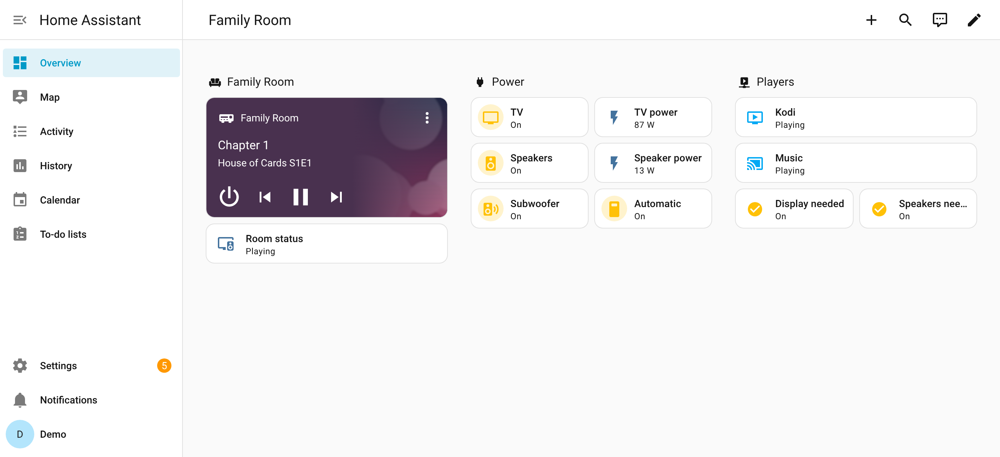
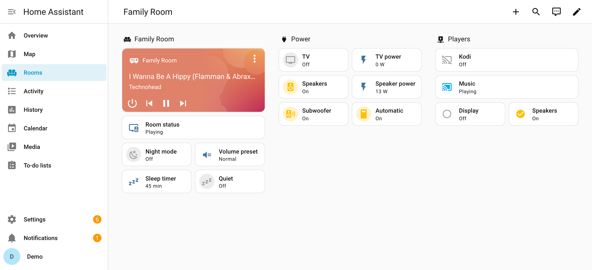
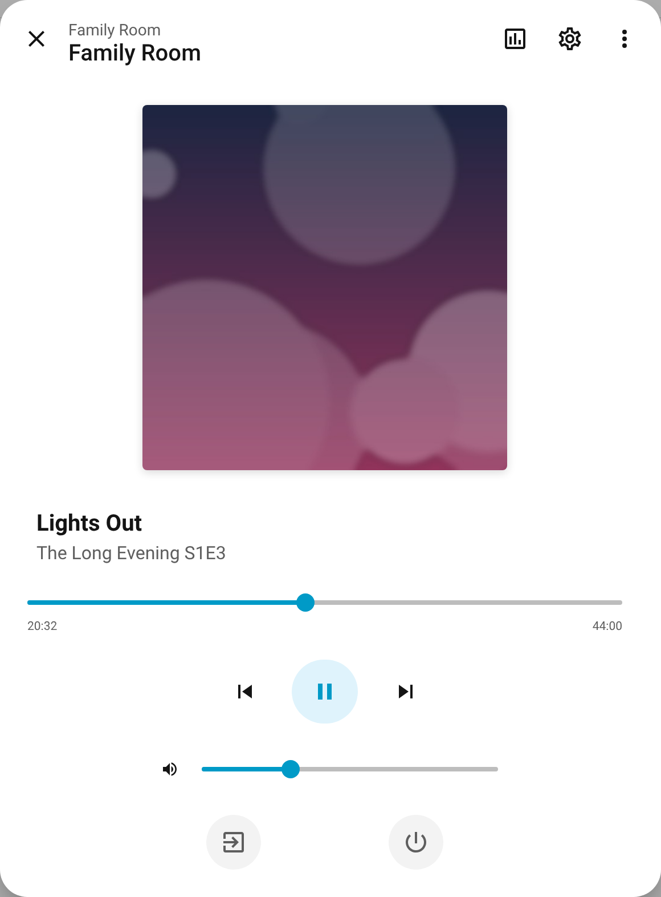
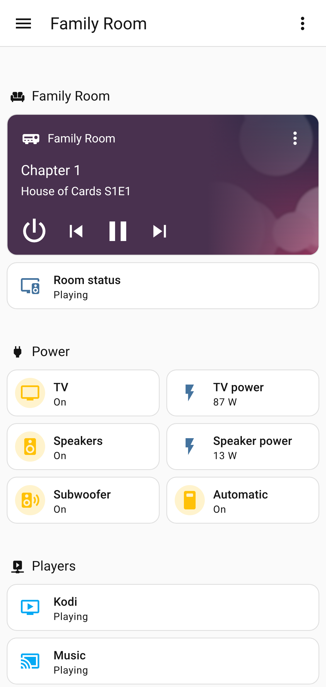
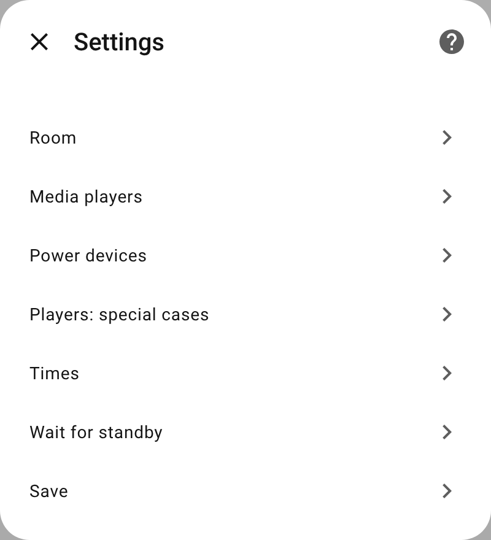
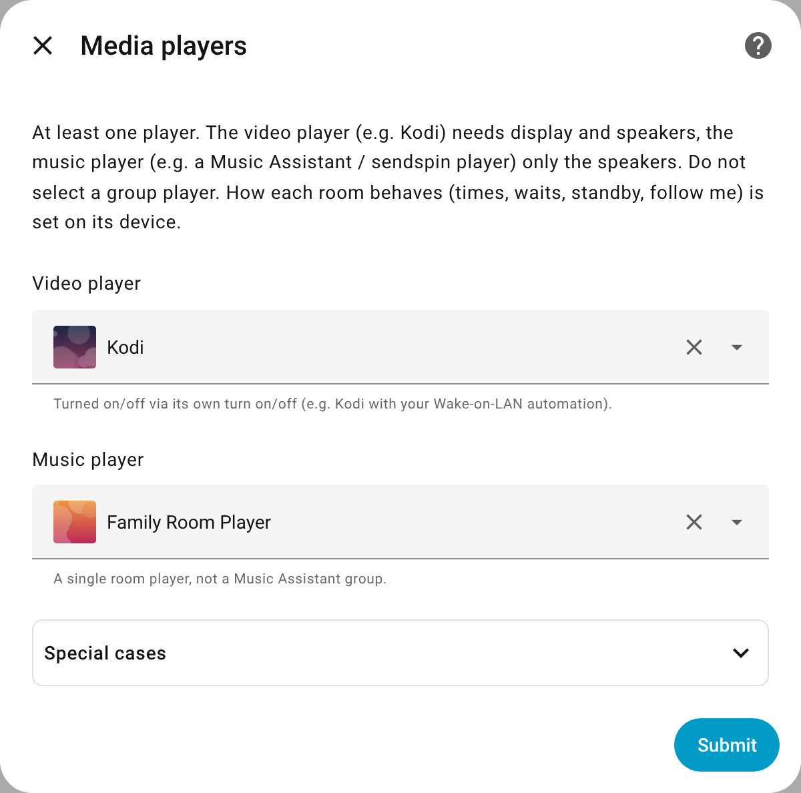
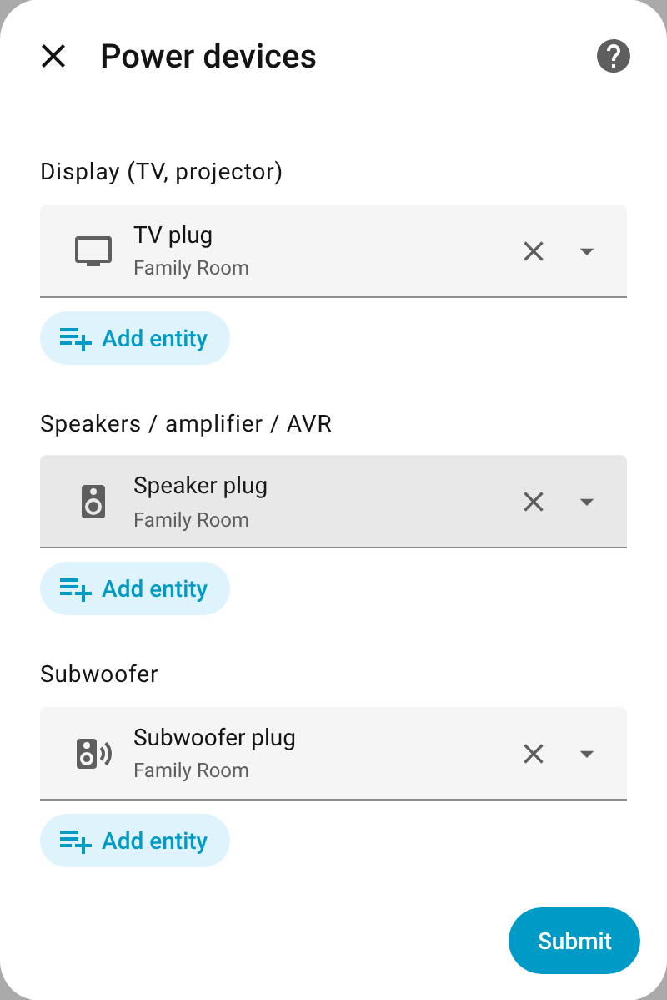
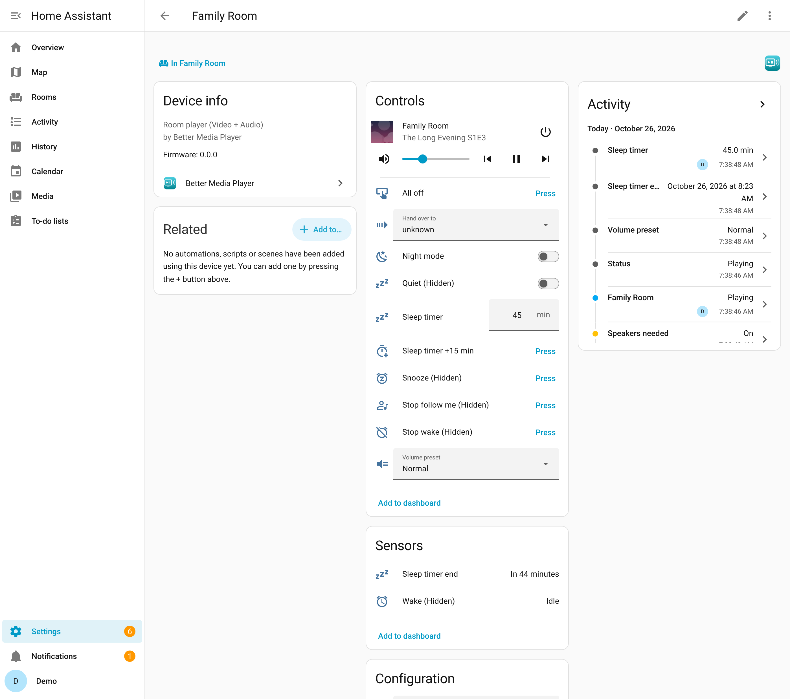
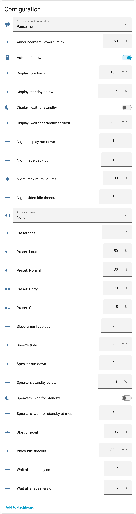

# Better Media Player

**One smart media player per room.** Better Media Player combines a room's media players (e.g. Kodi and a Music Assistant player) and its TV, speakers and subwoofer into a single Home Assistant entity. Press play and the right devices come on in a safe order; when nothing needs them any more, they go off again by themselves.

It is a custom integration in the spirit of Better Thermostat: you tell it what is in the room, it takes care of the rest.



> **Status:** early development.

## Contents

- [What it does](#what-it-does)
- [Is it for you?](#is-it-for-you)
- [Screenshots](#screenshots)
- [Installation](#installation)
- [Setup](#setup)
- [How the room behaves](#how-the-room-behaves)
- [Features](#features): [room volume](#room-volume), [night mode](#night-mode), [sleep timer](#sleep-timer), [wake up](#wake-up), [follow me](#follow-me), [handover](#handover), [media browser](#media-browser-and-search)
- [Automations](#automations): actions, events, device triggers
- [Dashboards](#dashboards)
- [Reference](#reference): entities and states
- [Players of other systems](#players-of-other-systems)
- [License](#license)

## What it does

- **Power in the right order:** press play on Kodi → the TV comes on, Kodi wakes up, then the speakers; speakers never pop and a player is only used once it is ready.
- **Shared speakers:** one set of speakers (plus subwoofer) serves both a video player such as Kodi and a music player such as Music Assistant.
- **On and off by itself:** music that starts on the room's player – also as part of a Music Assistant group – powers the speakers. When nothing plays any more, everything goes off after a while (e.g. the TV 10 min after Kodi is off).
- **Plugs or devices:** TV, speakers and subwoofer can hang on switchable plugs, turn themselves on and off (a TV or AV receiver as media player, a remote), be switched by your own scripts (e.g. IR) – or a mix.
- **Room off:** leaves a Music Assistant group, stops playback, turns the video player off and powers everything down.
- **One volume per room**, with presets (quiet, normal, loud, party) – on the players or on an amplifier, AV receiver or soundbar.
- **Night mode, sleep timer and wake up** with fades.
- **Follow me:** start it in a room and the music moves with you from room to room, using the rooms' occupancy sensors and one Music Assistant group player.
- **Handover:** continue the music or the film in another room, where it was.
- **Media browser and search** across all of the room's players, with their queues on top; picking a movie powers up TV and Kodi first.
- **Manual override:** switch a plug (or turn a device on) by hand and the room steps back until everything is off again.
- **Tidy dashboards:** controls that make no sense right now are hidden.
- **For your own automations:** events for source changes, night mode, sleep timer and wake up; device triggers for source changes and night mode.

## Is it for you?

**It fits if**

- a room has a video player (e.g. Kodi) and/or a music player (e.g. a Music Assistant player);
- TV, speakers or subwoofer hang on switchable plugs (and start by themselves when they get power), turn on and off by themselves (a media player or a remote, e.g. a TV via webOS or CEC, an AV receiver, a Harmony hub), are switched by your own scripts (e.g. IR), or a mix of these;
- an AV receiver or TV switches between the players: with an automation on the [source change event](#source-changes);
- the room's volume is set on the players, or on an amplifier, AV receiver or soundbar with its own volume (a media player or a number);
- for follow me: occupancy sensors in the rooms and one Music Assistant group player with dynamic members.

**It does not fit (yet) if**

- several rooms (zones) hang on one device.

## Screenshots

Taken from the Home Assistant demo integration: two demo players stand in for Kodi and a Music Assistant player, the plugs are template switches ([how](scripts/screenshots/README.md)).

**Movie night** (the screenshot at the top): Kodi plays, so the TV, the speakers and the subwoofer have power. The room player shows what is playing and controls it.

**Music only:** after switching the source to music, Kodi is turned off and the TV plug is cut. Speakers and subwoofer stay on for the music.



**Room player:** one entity with power, transport, source selection and the media info of the active player.



**Mobile:**



The device page and the settings are shown under [Setup](#setup).

## Installation

Requires Home Assistant 2025.2 or newer.

### HACS

[](https://my.home-assistant.io/redirect/hacs_repository/?owner=financelurker&repository=ha-better-media-player&category=integration)

1. Click the button above. It opens the repository in HACS and adds it as a custom repository if needed.
2. Install **Better Media Player** and restart Home Assistant.

Without the button: HACS → ⋮ → **Custom repositories** → add `https://github.com/financelurker/ha-better-media-player` as type *Integration*.

### Manual

1. Copy `custom_components/better_media_player` into `config/custom_components/`.
2. Restart Home Assistant.

## Setup

> **Before you start**
>
> - Every plug and device belongs to exactly one controller. Disable automations, scripts or helpers that switch the same plugs or devices (Settings → Entities → plug → **Related** shows them). Devices on a plug alone must start by themselves when they get power.
> - **Kodi:** Home Assistant cannot switch Kodi on or off by itself: `turn_on` / `turn_off` only fire Kodi's device triggers. Keep your Wake-on-LAN and suspend automations on these triggers; they do the actual work.

[](https://my.home-assistant.io/redirect/config_flow_start/?domain=better_media_player)

Settings → Devices & services → Add integration → **Better Media Player** → **A room**, once per room. For follow me, or to change the [dynamic controls](#dashboards), add **Central settings** once as well.

The setup only asks what is connected:

| Step | What you enter |
|---|---|
| **New room** | Name and area. Kodi (also Better Kodi) and Music Assistant players of the area are pre-selected in the next step. |
| **Media players** | Video player (e.g. Kodi) and/or music player (the room's own player, not a group). *Special cases* (collapsed): on/off actions for a player that cannot turn itself on/off, plugs its hardware hangs on. |
| **Devices and volume** | Display (TV, projector), speakers (one or more: active speakers, amplifier, AVR), subwoofer: plugs and/or [devices](#devices-instead-of-plugs). Where the room's volume is set: on the players, or on an own device. *Own on/off actions* (collapsed): scripts or buttons for a device only they switch. *Wait for standby* (collapsed): power sensors. *Follow me* (collapsed): occupancy sensors; rooms without them do not take part. |

Everything can be changed later via **Configure**. How the room behaves is set on its device (below).

| Menu | Media players | Devices and volume |
|---|---|---|
|  |  |  |

### Examples

| Room | Media players | Power devices |
|---|---|---|
| TV room | Kodi | TV, speakers |
| Office | Music Assistant player | speakers |
| Living room | Kodi + Music Assistant player | TV, speakers (shared), subwoofer |
| Home cinema | Kodi + Music Assistant player | TV (webOS, as media player; keep its [Wake-on-LAN automation](#devices-instead-of-plugs)), AV receiver on a plug (plug, then the receiver) with the room volume on the receiver, subwoofer by IR scripts (an on and an off action) |

### Settings on the device

Each room is a device (Settings → Devices & services → Better Media Player → the room). Its page shows the status, what is needed right now, automatic power, the *All off* button and the room's controls:



How the room behaves – times, waits, standby, night mode, volume presets and follow me – is set under *Configuration* on that page. These are configuration entities: they take effect at once, can be set by automations (`number.set_value`, `switch.turn_on`, `select.select_option`; entity ids under [Reference](#entities)) and do not show up on auto-generated dashboards. A room only has the ones it can use; to start, you can leave them all at their defaults:

| Entity | Default | Present |
|---|---|---|
| Display run-down, Speaker run-down, Player hardware run-down | 10 / 2 / 2 min | with that device |
| Video idle timeout | 30 min | with a video player |
| Start timeout | 90 s | always |
| Wait after display on, Wait after speakers on, Wait after player plug on | 0 s | with that device |
| Display / Speakers: wait for standby, … standby below, … wait for standby at most | off; 5 / 3 W; 20 / 5 min | with power sensors and a plug for it |
| Night: maximum volume, Night: video idle timeout, Night: display run-down, Night: fade back up | | see [night mode](#night-mode) |
| Preset: Quiet / Normal / Loud / Party, Power-on preset, Preset fade | 15 / 30 / 50 / 70 %, none, 3 s | see [presets](#presets) |
| Sleep timer fade-out, Snooze time | 5 / 9 min | always |
| Follow me: leave after, Follow me: volume offset, Follow me: prewarm speakers, Wake: detect leaving the room | | in follow rooms, see [follow me](#follow-me) |

<details>
<summary>Screenshot: the settings of a room</summary>



</details>

The **Central settings** device has *Follow me: default volume*, *Dynamic controls* and *Hide delay*; its **Configure** only asks for the follow-me player.

## How the room behaves

### Power button and sources

- **On** starts the last used source; the first time after setup that is the video player. The last source survives restarts.
- **Source** selects video or music explicitly. The other source is stopped (Kodi off, music leaves its group or is paused).
- **Off** (or **All off**): leave a Music Assistant group with `media_player.unjoin` (if it was the last member, Music Assistant pauses the group), otherwise stop direct playback; turn the video player off; switch all plugs and devices off in order. A player that takes a while to stop does not switch the room back on; only new playback does.
- **Volume and transport** go to the player that is currently active.

### Order

| | Sequence |
|---|---|
| **On** | player hardware plug → display → wake the player and wait until it is ready → speakers → subwoofer |
| **Off** | subwoofer → speakers → display → player hardware plug |

If the player is not ready within the start timeout (90 s), everything switched on is switched off again and the room reports an error.

### When devices go off

| Device | Needed while … | Run-down (default) |
|---|---|---|
| Display | the video player is on (menu, paused, playing) | 10 min |
| Speakers, subwoofer | the video player is on **or** music is playing | 2 min |
| Player hardware | its player is active | 2 min |

Paused music is not demand: the speakers switch off after the run-down and on again when playback resumes. A video player that sits idle in its menu is turned off after 30 min.

### Devices instead of plugs

Display, speakers and subwoofer can also be devices that turn themselves on and off, alone or together with plugs (the player hardware stays a plug):

| Kind | Switched with | On when |
|---|---|---|
| Plug (`switch`, `light`, `input_boolean`) | `turn_on` / `turn_off` | `on` |
| Media player (TV, AV receiver, soundbar) | `media_player.turn_on` / `turn_off` | on, idle, playing, paused |
| Remote (e.g. a Harmony activity) | `remote.turn_on` / `turn_off` | `on` |
| Own on/off actions (script, button, scene, automation) | the on / the off action | what was sent last (no feedback) |

- **Plug and device in one role:** on: the plug, then the device once it is there (at most the start timeout; a device that does not come is left out until the next start). Off: the device first, the plug once the device reports off (at most 60 s), after the standby wait if switched on (only a role with a plug waits for standby).
- **One device in two roles** (e.g. a TV with its own speakers as display and speakers): it goes off only when no role needs it any more.
- **TV inputs and AV receiver inputs** are not switched by the room: use an automation on the [source change event](#source-changes).
- **A TV that only an automation can turn on** (e.g. webOS with Wake-on-LAN): keep that automation for its turn-on trigger, as with Kodi.

### Wait for standby

With power sensors and a plug in the role (and the device's switch *Display: wait for standby* / *Speakers: wait for standby* on), a plug is cut only after its device has drawn less than the threshold for 30 s, at most after the maximum wait. Useful for OLED TVs that run panel care in standby. A TV that never goes to standby on its own (no CEC) gains nothing from this; then only the run-down applies.

### Switched by hand

- **A plug switched by hand**, or a device turned on by hand while nothing needs it (e.g. live TV): **manual mode**. The room switches nothing by itself until everything is off again, or until you turn the room player on or off (that also ends it).
- **A device turned off by hand** while it is needed (e.g. the TV with its own remote): it stays off until the next start; everything else goes on automatically.
- **A device turned on by hand while it is needed** (e.g. woken by another device over HDMI-CEC) simply counts as on.
- **Automatic power** (switch on the device) off: no automatic switching at all; commands to the room player still work. Switching it back on ends manual mode too.

## Features

### Room volume

A room has one volume, not one per player. It is the volume last chosen in the room: on the room player, or directly on one of its players (Music Assistant app, Kodi remote, ...). When a player of the room starts to play on its own, it gets that volume: switching from music to a film keeps the volume, and so does starting a film by casting to Kodi.

- Assumption: the room's players are about equally loud at the same volume level.
- Playback started through the room player gets the volume before it plays. Playback started on the player itself is adjusted a moment after it starts (Home Assistant learns about it only then).
- Group playback (Music Assistant groups, follow me) is left alone: there the group decides. A player still joined to a group that does not play right now counts as in the group, unless it plays on its own (an idle group may still list players that play elsewhere, e.g. Music Assistant's *All players*). The room's volume comes back with the next playback of the room on its own.
- What Better Media Player sets itself (sleep timer, follow me's join volume) does not change the room volume.
- Players that cannot set a volume take no part; the setup shows a note for them.
- The room player shows the room volume in the attribute `room_volume`; `volume_level` is the volume of the active player.

#### On an own device

With an amplifier, AV receiver or soundbar that has its own volume, choose **Room volume: Own device** and the **Volume device** in *Devices and volume*: a media player that can set a volume, or a `number` / `input_number` (its range counts as 0–100 %, e.g. −80…0 dB).

- The room's volume is the device's. Volume, steps and mute of the room player go there (mute only with a media player); changes on the device itself (its remote, its app) are learned, also during group playback.
- The players keep their own level: set it once yourself (e.g. Kodi at 100 %). Better Media Player does not change it; after group playback (below) a player gets its own level back when it plays on its own again.
- Sleep timer fade, wake fade, night mode limit and the fade back after the night act on the device.
- While the device is off, a volume set on the room player is remembered; the device gets the room's volume as soon as it is up again (e.g. after its plug switched on), whatever it comes back with.
- **Groups and follow me** still set the players' volume (follow me's volume plus the room's offset): there the group decides. The night mode limits the device, not the player in the group. Started in such a room, follow me keeps its last volume (the player's own level says nothing about loudness).
- Switching between players and a device (or to another device) in the options starts the room volume afresh: it is learned from the new output.
- The note about players that cannot set a volume is not shown: the device sets it.

#### Presets

Room volumes by name: **quiet**, **normal**, **loud** and **party** (default 15 / 30 / 50 / 70 %; 0 = not offered in the room). Their volumes are number entities on the device (`Preset: Quiet` etc., `number.<room>_preset_quiet`). Changing the chosen preset's volume sets it right away; a preset set to 0 is no longer offered (the volume stays). Choose one with the select `Volume preset` or the action below; this works with players and with a volume device alike.

```yaml
action: better_media_player.set_volume_preset
target:
  entity_id: media_player.living_room
data:
  preset: loud
  fade_seconds: 5           # optional; default: the room's preset fade, 0 = at once
```

- The preset becomes the room volume at once (the select shows it right away); the volume of what plays **fades** there: *Preset fade* on the device (default 3 s, slow at the start and at the end; 0 = it jumps), or `fade_seconds` of the action. Changing the volume during the fade stops it there (that is the room volume then, *manual*); choosing another preset fades on from where the volume is. The night mode (its limit holds), the sleep timer, a wake and follow me take over from a fade; turning the room off ends it. In a group (Music Assistant groups, follow me) it is only remembered: there the group decides; the room gets it with its next playback on its own (with a volume device: right away on the device).
- It stays chosen until the volume is changed otherwise; then the select shows **manual** (choosing *manual* keeps the volume as it is). The room player shows it in the attribute `volume_preset`.
- **Night mode:** a preset above the limit is limited, stays chosen and comes back when the night ends.
- **Power-on preset** (select on the device, default none; skipped while its volume is 0): the room volume whenever the room comes on (one of its players is used again after everything was off), e.g. not at last night's party volume. It fades too, from the volume the player starts with. Not after a restart of Home Assistant with the room already on, not when a player drops out for a moment, and not for follow me's prewarm.

### Night mode

The switch `Night mode` puts the room into night mode until it is turned off again. Turning it on and off is up to you or to other integrations and automations (e.g. at bedtime and in the morning).

- **No subwoofer:** it stays off, also when follow me prewarms the speakers. Turned on during playback, the subwoofer goes off at once; turned off, it comes back if something plays. With automatic power off or in manual mode, nothing is switched.
- **Video:** still turns the display on, with shorter times: idle timeout 5 min instead of 30, display run-down 1 min (the display still goes after the speakers).
- **Volume limit** (default 30 %, 0 = none) for both players of the room (with a [volume device](#on-an-own-device): for the device), whoever sets the volume. What Better Media Player sets itself is limited before it is sent; a higher volume set elsewhere (app, remote) is set back as soon as it is reported, so it may be louder for a moment. A wish above the limit counts as the limit for the room volume.
- **Groups:** a room's player in a group is limited like any other. The group itself is limited only when all its players belong to rooms in night mode. When a room leaves the night mode, its player fades back to the group's volume (follow me: the remembered volume plus the room's offset; other groups: the group's volume from before the night); the group volume itself is not raised, as that would raise the players still in night mode too. A limited volume is never remembered as follow me's volume.
- **Afterwards:** the volume fades back to the room volume (default over 2 min); a volume change during the fade stops it. If nothing plays, the room volume is set at once. A restart during the fade continues it.
- **Sleep timer:** turning the night mode on during the sleep timer's fade keeps the fade going, below the limit.
- After a restart, or when the limit is lowered (number), the limit holds at once.
- `media_player.play_media` on the room player accepts `extra: {night_mode: true}` (or `false`) to switch the night mode along with the playback; it is not passed on to the player.

#### Anything else at night

Anything else at night (e.g. the AV receiver's night sound mode or dynamic range compression, the TV's picture mode) is up to you, with the event `better_media_player_night_mode`. It comes when the room's devices are up, so they take the command:

| `reason` | When |
|---|---|
| `switched` | the night mode was switched while the room is on (during a power-on sequence: once it is done) |
| `room_on` | the room came on (a source started after none) in night mode: every time, e.g. for a receiver that forgets its night mode with its power |
| `source` | another source started in night mode, e.g. the TV for video after music |

After the night mode was switched off while the room was off, the next `room_on` / `source` tells `night_mode: false` once. Data: `entity_id`, `entry_id`, `room`, `night_mode` (`true` / `false`), `reason`. It comes after the power-on sequence, right after the [source change event](#source-changes); like that event, not after a restart of Home Assistant with the room already on. Also as **device triggers**: *Night mode on (devices up)*, *Night mode off (devices up)*.

```yaml
trigger:
  - trigger: event
    event_type: better_media_player_night_mode
    event_data:
      room: Living room
action:
  - action: media_player.select_sound_mode
    target:
      entity_id: media_player.living_room_avr
    data:
      sound_mode: "{{ 'Night' if trigger.event.data.night_mode else 'Movie' }}"
```

### Sleep timer

The room turns itself off after a set time, whatever plays (video or music). Over the last minutes the volume of the active player fades out; then the normal *room off* runs and the volume from before the fade is set again, so the next playback does not start at zero. A player that is suspended at the end (e.g. Kodi) gets its volume when it is up again.

- Set it with the number `Sleep timer` (minutes, 0 = off; shows the minutes left), the button `Sleep timer +15 min` or the actions below. Only while the room is on.
- Turning the room off, or the room going off by itself, ends the timer. Cancelling during the fade sets the volume back.
- Changing the volume during the fade stops the fade only: your volume stays, and the timer still ends the room.
- *+15 min* during the fade sets the volume back; the fade starts again before the new end.
- The timer survives a restart of Home Assistant. If it ran out while Home Assistant was down, the room is turned off at the start only if something still plays.
- The event `better_media_player_sleep_timer_finished` (`entity_id`, `entry_id`, `room`, `reason`: `expired`, `cancelled` or `room_off`) is fired when the timer ends.

```yaml
action: better_media_player.set_sleep_timer
target:
  entity_id: media_player.bedroom
data:
  minutes: 45
  fade_minutes: 10   # optional, default: the room's Sleep timer fade-out (5 min)
```

`better_media_player.cancel_sleep_timer` stops it.

### Wake up

`better_media_player.wake` wakes one room: the room powers up as usual, the playback starts at the start volume and fades in once it really plays.

```yaml
action: better_media_player.wake
target:
  entity_id: media_player.bedroom
data:
  media_content_id: library://radio/42
  media_content_type: music
  start_volume: 0.05        # default 0.05; or a preset of the room, e.g. quiet
  target_volume: 0.3        # default: the room volume (power-on preset if the wake turns the room on); or a preset, e.g. normal
  fade_minutes: 10          # default 10
  max_duration_minutes: 60  # optional: then the sleep timer fades out and turns the room off
  night_mode: false         # optional: switch the night mode before
```

- **Which player:** media picked through the room player (media selector of an automation) names the player itself, so a film wakes on Kodi and turns the display on. Other media go to the music player, or to `source: video`.
- **No playback** within 60 s, or a failed start: the event `better_media_player_wake_failed` (`reason`: `start_failed` / `not_playing`) is fired so a different source can be tried, and the room goes off again if it was off before. A successful start fires `better_media_player_wake_started`.
- **Snooze** (button, `better_media_player.snooze` with optional `minutes`, default: the room's *Snooze time*, 9 min, or a pause on the player): pauses (or stops, if the player cannot pause), keeps the room powered, then continues at the start volume and fades in; a player that is no longer paused by then starts the media again. Snoozing during the start starts it again from the beginning afterwards. `max_duration` counts from the last start.
- A **volume change** by hand ends only the fade. Switching the night mode off during the wake lets the fade (or the volume) go up to the full target.
- **Already playing:** a wake replaces the playback; it counts as started once the new playback runs (or something plays at the play check).
- A player that goes idle for a moment (between two items) is no stop; only a stop that lasts 10 s ends the wake.
- **Ends** (`better_media_player_wake_finished`, `reason`): `stopped` (button / `better_media_player.stop_wake` / a stop on the player; the playback goes on unless stopped), `max_duration`, `room_off`, `sleep_timer` (a sleep timer set during the wake; the playback goes on), `replaced` (a new wake), `left` (with follow me, below). A wake ends a running sleep timer.
- What the wake sets is not taken as the room volume; the night mode's limit holds.
- It survives a restart: the fade and the snooze go on, a start cut by the restart is tried again (within 5 min).
- The sensor `Wake` shows `idle`, `starting`, `fading`, `playing` or `snoozed`. It and the buttons *Snooze* and *Stop wake* are hidden while no wake runs ([dynamic controls](#dashboards); pressing the buttons then does nothing). Cards that list them explicitly still show them; to show them only during a wake:

```yaml
type: conditional
conditions:
  - condition: state
    entity: sensor.bedroom_wake
    state_not: idle
card:
  type: entities
  entities:
    - button.bedroom_snooze
    - button.bedroom_stop_wake
```

Waking several rooms with one call wakes each on its own (not in sync).

#### With follow me

With `follow: true` the music follows you out of the wake room: the wake starts follow me (or joins it). It needs the central settings, a music player and occupancy sensors in the wake room.

- **The wake room** joins the follow-me player at its start volume and fades in its own player. Only it fades: rooms that join later get follow me's normal volume. Its quiet mode does not keep it out while it wakes.
- **Follow me off or running:** if follow me is off, the wake starts it with the wake's media; players left in the group from before (e.g. paused last night) leave it. Rooms that are occupied at that moment (someone already in the kitchen) stay out until their presence went and came again. If follow me already runs (or was just started by another wake), the wake room joins it and its media goes on.
- If Music Assistant drops the wake room from the group, it is taken back in; a group stopped in the app ends the wake. After a restart with the group stopped, the wake room joins again.
- **Left = woken up:** the wake is done (`wake_finished`, reason `left`) when presence was seen in the wake room after the wake started, the room then ran empty (presence run-down), **and** someone turned up in another follow room — from 2 min before the wake room was last occupied on (the sensor there may switch on first). The room leaves the group like any follow room; the music plays on where you are. A sensor that loses a sleeper for a while (mmWave) is no "left", nor is someone who got up much earlier. As long as no presence was seen, the wake room stays until the wake ends otherwise. The switch *Wake: detect leaving the room* on the room's device switches this off; then a follow wake there ends only by stop, maximum duration, room off or a sleep timer.
- **Snooze** only snoozes the wake room: it leaves the group meanwhile (the others play on; as the only member the group pauses) and comes back at the start volume. Follow me does not take it back in during the snooze.
- **Ends:** `stop_wake` makes it a normal follow room; `max_duration` fades out only the wake room, which then leaves the group; room off takes only this room out.
- Night mode is per room as always: a room in night mode joins without subwoofer and limited.

### Follow me

Needs the **Central settings** entry with the **follow-me player**: a Music Assistant group player with dynamic members (e.g. *All players*). There is one follow me per Home Assistant installation. Every other Music Assistant group simply plays: it powers the speakers of its members like direct playback.

> Group players with **static** members are not supported: Music Assistant stops the whole group when a static member is removed. Use groups with dynamic members only.

**Start** follow me in a room where music plays directly on its music player (not video, not in quiet mode), with the room's **Follow me** button or the action:

```yaml
action: better_media_player.start_follow
target:
  entity_id: media_player.living_room
```

The room joins the follow-me player and its queue moves there (`music_assistant.transfer_queue`); the track goes on where it was (if the follow-me player starts it from the beginning, it is set to the position; not for streams without a duration, e.g. radio). The room's volume becomes follow me's volume (its offset taken out). While follow me runs, the **Follow me** buttons are hidden in every room and the **Stop follow me** buttons are shown ([dynamic controls](#dashboards)); pressing *Follow me* while it runs, or *Stop follow me* while it does not, gives an error.

If follow me cannot be started in a room, the error says why. The button's attribute `blocked_by` shows the same reason (`null` while it can be started):

| `blocked_by` | Reason |
|---|---|
| `no_follow_player` | no follow-me player in the central settings |
| `follow_running` | follow me runs already |
| `start_not_follow_room` | the room takes no part (it needs a music player and occupancy sensors) |
| `start_quiet` | the room is in quiet mode |
| `start_video` | the video player is on |
| `start_follow_paused` | the music player is still in the follow-me player, which does not play: resume it, or start the music on the player itself |
| `start_in_group` | the music plays in a group (named in the error): start it on the player itself |
| `start_not_playing` | no music plays on the room's music player |

While it plays:

- **Prewarm:** the speakers of all follow rooms are switched on, so the sound is there as soon as you walk in.
- **Join:** a room with presence joins. Its volume is set first: follow me's volume plus the room's offset (e.g. bedroom −10 percentage points).
- **Leave:** a room without presence leaves after its presence run-down (2 min). When the last room leaves, Music Assistant pauses the group and follow me ends.
- **Never steals:** a room that plays something else (directly or in another group) is left alone.
- **Left out:** rooms with video playing (Kodi; when the video ends the room comes back, and if it was the last room the group resumes, within 3 h), rooms in **quiet** mode (switch per room; leaves at once and cuts the speakers) and rooms turned **off** during the session (until follow me ends).
- **Unknown presence** (all sensors unavailable) changes nothing, so music does not stop because a sensor integration is down.
- **Nobody detected** at the start: the start room stays as long as nobody is detected in any follow room; then the normal rules apply, including the run-down. The same goes for a room you add to the group by hand.
- **Paused by you:** follow me goes on, rooms stay as they are, the prewarmed speakers run down. On resume the rules apply again.

**Stop** follow me with any room's **Stop follow me** button or `better_media_player.stop_follow` (target: a room player). The music goes back to one room: the room you stop it in if it plays along, else the room it was started in (paused music stays paused there); playing music goes on there where it was. All other rooms stop. Stopping while follow me is off gives an error. Follow me also ends by itself when the follow-me player is stopped in Music Assistant.

### Handover

Continue what plays in one room in another: the music or the film goes on there, this room goes off. With the room's select **Hand over to** (it offers the rooms that can take it over, while something plays) or the action:

```yaml
action: better_media_player.handover
target:
  entity_id: media_player.living_room
data:
  destination: media_player.kitchen
  source: audio                 # optional: audio or video (default: what plays)
  keep_source_playing: false    # optional: this room plays on (Better Kodi only)
```

- **The destination powers up first** (its power sequence for that source: TV, player, speakers), then the playback moves: **music** with its queue, going on where the track was, paused music stays paused (Music Assistant); **video** with Better Kodi's handover (it continues where the film was). The destination plays at its own room volume (night mode and presets apply there).
- **What the destination played before** is replaced, as with a source change.
- **During follow me**, handing the music over ends follow me: the music goes to the destination, the other rooms stop.
- **This room goes off** afterwards (its sleep timer or wake end with it), unless `keep_source_playing` (only where the player's system can: Better Kodi; a Music Assistant queue moves), or its other source is in use (e.g. paused music handed over from behind a film: the film plays on).
- **Music in a group** (other than follow me) is not handed over: the group plays it, not the room's player.
- Both rooms need a player for the source with handover: the same system (two Music Assistant players, two Better Kodi players). Otherwise the action gives an error that says why (nothing plays, no such player in the destination, the system cannot hand over, …); errors of the player's own handover (e.g. Better Kodi's) are passed on.

### Media browser and search

The room player's media browser bundles the browsers of its players. Only what a player supports is offered.

| Entry | Content |
|---|---|
| **Queue: \<video player\>** | the video player's queue, if it has one (e.g. [Better Kodi](https://github.com/financelurker/ha-better-kodi)) |
| **Queue: \<music player\>** | Music Assistant: the current and the next item (that is all Home Assistant exposes) |
| **\<video player\>** | its browser. While it is off: Home Assistant's media sources (e.g. Jellyfin) and a hint |
| **\<music player\>** | its browser (artists, albums, playlists, radio, …) |

- **Playing now** from the browser switches the room to that player: the other player is stopped and the power sequence runs first. A movie picked while Kodi sleeps turns on the TV, wakes Kodi and then plays. A music player in a group leaves it first, so only this room changes.
- **Music items** open a small folder with **▶ Play now**, **⏭ Play next**, **➕ Add to queue** and **⟲ Replace queue** (if the player supports enqueueing). *Next* and *add* change nothing else in the room.
- **Search** goes to the players that can search (Music Assistant). Voice commands like "play Kid Rock in the living room" go to the room player and power the room.
- Media picked through the room player in an automation's media selector stores an id that only the room player understands.
- Browser labels follow the server language set in Home Assistant.

## Automations

### Actions

All of them target a room player (`media_player.<room>`).

| Action | What it does |
|---|---|
| `better_media_player.set_volume_preset` | choose a [volume preset](#presets) (`preset`, optional `fade_seconds`) |
| `better_media_player.set_sleep_timer` / `cancel_sleep_timer` | [sleep timer](#sleep-timer) (`minutes`, optional `fade_minutes`) |
| `better_media_player.wake` | [wake up](#wake-up) (`media_content_id`, `media_content_type`; optional `start_volume`, `target_volume`, `fade_minutes`, `max_duration_minutes`, `night_mode`, `source`, `follow`) |
| `better_media_player.snooze` / `stop_wake` | snooze (optional `minutes`) / stop a wake |
| `better_media_player.start_follow` / `stop_follow` | [follow me](#follow-me) |
| `better_media_player.handover` | [handover](#handover) (`destination`; optional `source`, `keep_source_playing`) |
| `media_player.play_media` with `extra: {night_mode: true}` | play and switch the [night mode](#night-mode) along |

### Events and device triggers

| Event | When | Device triggers |
|---|---|---|
| `better_media_player_source_changed` | the room's source changed ([below](#source-changes)) | *Source changed*, *Switched to video*, *Switched to music*, *Source off* |
| `better_media_player_night_mode` | night mode, once the devices are up ([details](#anything-else-at-night)) | *Night mode on (devices up)*, *Night mode off (devices up)* |
| `better_media_player_sleep_timer_finished` | the [sleep timer](#sleep-timer) ended | |
| `better_media_player_wake_started`, `_wake_failed`, `_wake_finished` | a [wake](#wake-up) started, failed or ended | |

### Source changes

When the room's source changes, the event `better_media_player_source_changed` is fired, e.g. to switch the TV input by IR. The source is `video` while the video player is on, `audio` while the music player plays (also in a group) or is paused while the room still has power for it, or `null` when no player is active any more. A source chosen through the room player (on, source, play, wake) is the room's source from then on, even before something plays (e.g. turned on with music) and during a snooze, until another source plays or the room goes off.

| Data | |
|---|---|
| `entity_id`, `entry_id`, `room` | the room player and the room |
| `source`, `previous` | `video`, `audio` or `null` |
| `player` | the player of the new source |
| `reason` | `selected` (through the room player: source, on, play, wake), `player` (a player took over by itself, e.g. a film cast to Kodi), `off` |

- Fired once the room is ready for it: after the power-on sequence, so the TV already has power (plus its wait after switching on).
- Only for a stable change: two players at the same time for a moment fire nothing. A pause, new media on the same player, a dropout of the current source's player or a restart of Home Assistant fire nothing either. Another player that is unavailable (e.g. behind its host plug) counts as off.
- The same as **device triggers** in the automation editor: *Source changed*, *Switched to video*, *Switched to music*, *Source off*.

```yaml
trigger:
  - trigger: event
    event_type: better_media_player_source_changed
    event_data:
      room: Living room
      source: video
action:
  - action: remote.send_command
    target:
      entity_id: remote.living_room_ir
    data:
      command: tv_input_hdmi1
```

## Dashboards

**Dynamic controls:** a room's controls that make no sense right now are hidden (`hidden_by: integration`), so the automatic dashboards only show what can be used. A control is shown at once when it makes sense again and hidden only after the hide delay (default 3 s), so a short stop between two items changes nothing. The room player and the night mode are always shown; settings and diagnostic entities are left alone.

| Control | Shown while |
|---|---|
| All off | the room plays or is on, or a device still has power (run-down, manual mode) |
| Sleep timer, Sleep timer +15 min | the room plays or is on, or a sleep timer runs |
| Sleep timer end | a sleep timer runs |
| Night mode | always (it is set ahead, also while nothing plays) |
| Quiet | always in a room that takes part in follow me (occupancy sensors, a music player, a follow-me player in the central settings); elsewhere while it is on |
| Wake, Snooze, Stop wake | a wake runs |
| Follow me / Stop follow me | it can be started here / follow me runs |
| Volume preset | the room plays or is on |
| Hand over to | something plays that another room can take over |
| central: Follow rooms | follow me runs |

- "Plays or is on": one of its players is used (video player on, music playing or paused, or turned on with a source), or the room is being turned on.
- A hidden control still works through actions and automations; a hidden button gives an error or does nothing.
- A control you hid stays hidden; one you show again stays shown.
- **Central settings:** the switch *Dynamic controls* (default on; off: nothing is hidden, in every room) and the number *Hide delay* (default 3 s) on its device. The follow-me player is optional there. Without central settings (none, disabled), the defaults apply.

## Reference

### Entities

| Entity | Description |
|---|---|
| `media_player.<room>` | the room player, with media browser and search |
| `sensor.<room>_status` | see table below |
| `binary_sensor.<room>_problem` | start failed; reason in the attributes |
| `binary_sensor.<room>_display_needed` | display demand right now |
| `binary_sensor.<room>_speakers_needed` | speaker demand right now |
| `switch.<room>_automatic_power` | off: no automatic switching; commands to the room player still work |
| `button.<room>_all_off` | same as turning the room player off |
| `number.<room>_sleep_timer` | sleep timer: minutes left, 0 = off |
| `button.<room>_sleep_timer_15_min` | sleep timer +15 min (starts one if none runs) |
| `sensor.<room>_sleep_timer_end` | when the sleep timer turns the room off |
| `switch.<room>_quiet` | quiet mode: the room takes no part in follow me |
| `switch.<room>_night_mode` | [night mode](#night-mode) |
| `sensor.<room>_wake` | wake state; snooze end, end time and volumes in the attributes |
| `button.<room>_snooze`, `button.<room>_stop_wake` | wake controls |
| `select.<room>_volume_preset` | volume preset (the offered presets and manual) |
| `select.<room>_hand_over_to` | [handover](#handover) to another room |
| `sensor.<room>_follow` | follow state of the room (with occupancy sensors only) |
| `button.<room>_follow_me`, `button.<room>_stop_follow_me` | start / stop follow me |
| `sensor.better_media_player_follow_rooms` | central: rooms in follow me; follow-me player, start room in the attributes |

Settings ([what they do](#settings-on-the-device)); only those the room can use:

| Entity | Unit |
|---|---|
| `number.<room>_display_run_down`, `_speaker_run_down`, `_player_hardware_run_down`, `_video_idle_timeout` | min |
| `number.<room>_start_timeout`, `_wait_after_display_on`, `_wait_after_speakers_on`, `_wait_after_player_plug_on` | s |
| `switch.<room>_display_wait_for_standby`, `switch.<room>_speakers_wait_for_standby` | on / off |
| `number.<room>_display_standby_below`, `_speakers_standby_below` | W |
| `number.<room>_display_wait_for_standby_at_most`, `_speakers_wait_for_standby_at_most` | min |
| `number.<room>_night_maximum_volume` | %, 0 = no limit |
| `number.<room>_night_video_idle_timeout`, `_night_display_run_down`, `_night_fade_back_up` | min |
| `number.<room>_preset_quiet`, `_preset_normal`, `_preset_loud`, `_preset_party` | %, 0 = not offered |
| `select.<room>_power_on_preset` | none or a preset |
| `number.<room>_preset_fade` | s, 0 = at once |
| `number.<room>_sleep_timer_fade_out`, `_snooze_time` | min |
| `number.<room>_follow_me_leave_after` | min |
| `number.<room>_follow_me_volume_offset` | percentage points |
| `switch.<room>_follow_me_prewarm_speakers`, `switch.<room>_wake_detect_leaving_the_room` | on / off |
| `number.better_media_player_follow_me_default_volume`, `_hide_delay`, `switch.better_media_player_dynamic_controls` | central: %, s, on / off |

### Status

| Status | Meaning |
|---|---|
| `off` | everything without power |
| `starting` | power-on sequence running |
| `on` | a source is active but not playing |
| `playing` | a source is playing |
| `run_down` | plugs or devices still on, no demand |
| `stopping` | waiting for a device to reach standby |
| `manual` | a plug was switched (or a device turned on) by hand; automatic switching paused |
| `error` | start failed |
| `disabled` | automatic power is off |

### Follow state

| Follow state | Meaning |
|---|---|
| `inactive` | follow me is off |
| `following` | the room plays along |
| `waiting` | prewarmed, waiting for presence |
| `override` | kept while nobody is detected (start or manual join without presence) |
| `excluded_quiet` / `excluded_video` / `excluded_off` | left out: quiet mode / video / turned off this session |
| `excluded_busy` | plays something else (directly or in another group) |
| `presence_unknown` | occupancy sensors unavailable; nothing changes |
| `waking` / `snoozed` | wake room of a follow wake / snoozed (out of the group meanwhile) |
| `held_out` | occupied when a follow wake started: joins once its presence went and came again |

## Players of other systems

Any media player can be the room's video or music player. The room then uses what Home Assistant offers for every media player: on, off, play, volume and browsing; a video player counts as active while it is on (also in its menu) and is browsed only while it is on (Home Assistant's media sources stand in while it is off); a music player counts as active while it plays and can be browsed while it is off (one with an on/off of its own, e.g. Music Assistant's power control: turned on, its speakers come up for the speaker run-down; it goes off once its speakers have run down, not while it is in a group or a wake is on); a player in a group is noticed by the group's members, and turning the room off takes it out with `media_player.unjoin`.

What a particular system does on top, or differently, lives in a backend of its own (`backend.py`):

| System | Backend | What it adds |
|---|---|---|
| Kodi | `kodi.py` | nothing beyond the video player's defaults |
| Better Kodi | `kodi.py` | its queue is lifted to the room's root; its own play next / add entries are read; handover (also playing on) |
| Music Assistant | `music_assistant.py` | its group players (not taken as a room's player), the queue in the browser, moving a queue with the position of the current track (follow me, handover) |

**Music Assistant's power control:** the room switches the devices (speakers, subwoofer, plugs). Don't set a plug the room switches as a player's *Power Control* in Music Assistant as well: two systems would switch it. To see on/off in Music Assistant, set *Fake power control*: the room then turns the player on with the room (also before follow me joins it) and off with it. Turned on in Music Assistant, the speakers come up; if nothing plays within the speaker run-down, the player and the speakers go off. Paused or stopped, the player goes off once its speakers have run down.

Another system is one more module with a subclass of `VideoBackend` or `MusicBackend`, added to the list in `backend.py` (contributions welcome). Follow me works with Music Assistant only: it needs a group player and a system that can move a queue.

## License

Eclipse Public License 2.0, see [LICENSE](LICENSE).

This project is not affiliated with Home Assistant, the Open Home Foundation, Kodi or Music Assistant.
