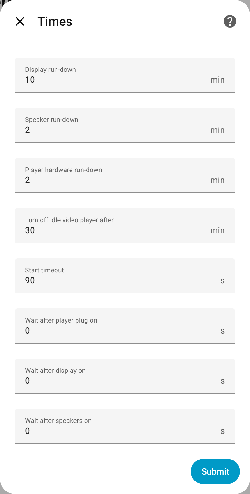

# Better Media Player

One smart media player per room: your room's media players and the power plugs of TV, speakers and subwoofer, combined into a single Home Assistant entity.

Better Media Player is a custom integration in the spirit of Better Thermostat. Each room gets one `media_player` entity that knows which of its players is active, powers the right devices in a safe order and switches them off again when nothing needs them.

- **Power sequencing:** devices are switched in a fixed order, so speakers never pop and the player is only used once it is ready.
- **Shared speakers:** one set of speakers (plus subwoofer) serves both a video player such as Kodi and a music player such as Music Assistant.
- **Auto-on:** music that starts on the room player, also as part of a Music Assistant group, powers the speakers by itself.
- **Room off:** leaves a Music Assistant group, stops playback, turns the video player off and powers everything down.
- **Manual override:** switch a plug by hand and the room steps back until all plugs are off again.
- **Follow me:** music on a Music Assistant follow group moves with you from room to room, using the room's occupancy sensors.
- **Media browser and search:** browse and search all of the room's players in one place, with their queues on top; picking a movie powers up TV and Kodi first.

## Screenshots

Taken from the Home Assistant demo integration: two demo players stand in for Kodi and a Music Assistant player, the plugs are template switches ([how](scripts/screenshots/README.md)).

**Movie night:** Kodi plays, so the TV, the speakers and the subwoofer have power. The room player shows what is playing and controls it.


**Music only:** after switching the source to music, Kodi is turned off and the TV plug is cut. Speakers and subwoofer stay on for the music.


**Room player:** one entity with power, transport, source selection and the media info of the active player.


**Device page:** status, demand sensors, automatic power, run-down times and the *All off* button.


**Settings:** every part of the setup can be changed later via **Configure**.

| Menu | Media players | Power devices | Times |
|---|---|---|---|
|  |  |  |  |

**Mobile:**


> **Status:** early development.

## Installation

Requires Home Assistant 2025.2 or newer.

### HACS

[](https://my.home-assistant.io/redirect/hacs_repository/?owner=financelurker&repository=ha-better-media-player&category=integration)

1. Click the button above. It opens the repository in HACS and adds it as a custom repository if needed.
2. Install **Better Media Player** and restart Home Assistant.

Without the button: HACS → ⋮ → **Custom repositories** → add `https://github.com/financelurker/ha-better-media-player` as type *Integration*.

### Manual

1. Copy `custom_components/better_media_player` into `config/custom_components/`.
2. Restart Home Assistant.

## Usage

[](https://my.home-assistant.io/redirect/config_flow_start/?domain=better_media_player)

Settings → Devices & services → Add integration → **Better Media Player** → **A room**, once per room. For follow me, add **Central settings** once as well.

| Step | What you enter |
|---|---|
| **New room** | Name and area. Kodi and Music Assistant players of the area are pre-selected in the next step. |
| **Media players** | Video player (e.g. Kodi) and/or music player (the room's own player, not a group). |
| **Power devices** | Display (TV, projector), speakers (one or more: active speakers, amplifier, AVR), subwoofer. |
| **Players: special cases** | Only if a player cannot turn itself on/off (on/off action) or its hardware hangs on a plug. |
| **Times** | Run-down times, video idle timeout, start timeout, waits after switching on, default sleep timer fade-out, snooze time. |
| **Wait for standby** | Optional, needs power sensors. |
| **Night mode** | Volume limit, video times at night, fade back afterwards. |
| **Follow me** | Occupancy sensors, presence run-down, volume offset, prewarm. Rooms without occupancy sensors do not take part. |

Everything can be changed later via **Configure**.

> **Before you start:** every plug belongs to exactly one controller. Disable automations, scripts or helpers that switch the same plugs (Settings → Entities → plug → **Related** shows them). Devices must start by themselves when they get power.

> **Kodi:** `turn_on` / `turn_off` only fire Kodi's device triggers. Keep your Wake-on-LAN and suspend automations for these triggers; they do the actual work.

### Scenarios

| Room | Media players | Power devices |
|---|---|---|
| TV room | Kodi | TV, speakers |
| Office | Music Assistant player | speakers |
| Living room | Kodi + Music Assistant player | TV, speakers (shared), subwoofer |

## How it decides

### Order

| | Sequence |
|---|---|
| **On** | player hardware plug → display → wake the player and wait until it is ready → speakers → subwoofer |
| **Off** | subwoofer → speakers → display → player hardware plug |

If the player is not ready within the start timeout (90 s), everything switched on is switched off again and the room reports an error.

### Demand and run-down

| Device | Needed while … | Run-down |
|---|---|---|
| Display | the video player is on (menu, paused, playing) | 10 min |
| Speakers, subwoofer | the video player is on **or** music is playing | 2 min |
| Player hardware | its player is active | 2 min |

Paused music is not demand: the speakers switch off after the run-down and on again when playback resumes. A video player that sits idle in its menu is turned off after 30 min.

### Power button and sources

- **On** starts the last used source; the first time after setup that is the video player. The last source survives restarts.
- **Source** selects video or music explicitly. The other source is stopped (Kodi off, music leaves its group or is paused).
- **Off** (or **All off**): leave a Music Assistant group with `media_player.unjoin` (if it was the last member, Music Assistant pauses the group), otherwise stop direct playback; turn the video player off; switch all plugs off in order. A player that takes a while to stop does not switch the room back on; only new playback does.
- **Volume and transport** go to the player that is currently active.

### Follow me

Needs the **Central settings** entry. There you assign each Music Assistant group player a policy:

| Policy | Behaviour |
|---|---|
| **Follow** | The music follows the people (see below). |
| **Always** | Playback in the group powers the speakers of its members, like direct playback. |
| *(not listed)* | Ignored: playback in the group powers nothing. Without central settings every group counts. |

While a follow group plays:

- **Prewarm:** the speakers of all follow rooms are switched on, so the sound is there as soon as you walk in.
- **Join:** a room with presence joins the group. Its volume is set first: group volume plus the room's offset (e.g. bedroom −10 percentage points).
- **Leave:** a room without presence leaves after its presence run-down (2 min). When the last room leaves, Music Assistant pauses the group, and the speakers switch off after their run-down.
- **Never steals:** a room that plays something else (directly or in another group) is left alone.
- **Left out:** rooms with video playing (Kodi; when the video ends the room comes back, and if it was the last room the group resumes, within 3 h), rooms in **quiet** mode (switch per room; leaves at once and cuts the speakers) and rooms turned **off** during the session (until the session ends).
- **Unknown presence** (all sensors unavailable) changes nothing, so music does not stop because a sensor integration is down.
- **Manual and fallback rooms** without presence stay as long as nobody is detected in any follow room; then the normal rules apply, including the run-down.
- **Paused by you:** the session goes on, rooms stay as they are, the prewarmed speakers run down. On resume the rules apply again.
- One follow group plays at a time; starting another one empties the older group (it pauses).

An empty group cannot start, so start follow in Music Assistant with at least one room, with the **Start follow** button, or from scripts and automations:

```yaml
action: better_media_player.start_follow
data:
  group: media_player.all_players_follow   # optional, default: first follow group
  media_content_id: "library://radio/42"   # optional, default: continue the last queue
  media_content_type: music                # optional
  volume: 0.15                             # optional, group volume 0-1; offsets still apply
  fallback_rooms:                          # optional, when nobody is detected (rooms with occupancy sensors)
    - media_player.bedroom
```

> Group players with **static** members are not supported: Music Assistant stops the whole group when a static member is removed. Use groups with dynamic members only.

### Media browser and search

The room player's media browser bundles the browsers of its players. Only what a player supports is offered.

| Entry | Content |
|---|---|
| **Queue: \<video player\>** | the video player's queue, if it has one (e.g. [Better Kodi](https://github.com/financelurker/ha-better-kodi)) |
| **Queue: \<music player\>** | Music Assistant: the current and the next item (that is all Home Assistant exposes) |
| **\<video player\>** | its browser. While it is off: Home Assistant's media sources (e.g. Jellyfin) and a hint |
| **\<music player\>** | its browser (artists, albums, playlists, radio, …) |

- **Playing now** from the browser switches the room to that player: the other player is stopped and the power sequence runs first. A movie picked while Kodi sleeps turns on the TV, wakes Kodi and then plays. A music player in a group leaves it first, so only this room changes.
- **Music items** open a small folder with **▶ Play now**, **⏭ Play next**, **➕ Add to queue** and **⟲ Replace queue** (if the player supports enqueueing). *Next* and *add* change nothing else in the room.
- **Search** goes to the players that can search (Music Assistant). Voice commands like "play Kid Rock in the living room" go to the room player and power the room.
- Media picked through the room player in an automation's media selector stores an id that only the room player understands.
- Browser labels follow the server language set in Home Assistant.

### Room volume

A room has one volume, not one per player. It is the volume last chosen in the room: on the room player, or directly on one of its players (Music Assistant app, Kodi remote, ...). When a player of the room starts to play on its own, it gets that volume: switching from music to a film keeps the volume, and so does starting a film by casting to Kodi.

- Assumption: the room's players are about equally loud at the same volume level.
- Playback started through the room player gets the volume before it plays. Playback started on the player itself is adjusted a moment after it starts (Home Assistant learns about it only then).
- Group playback (Music Assistant groups, follow me) is left alone: there the group decides. A player still joined to a group that does not play right now counts as in the group. The room's volume comes back with the next playback of the room on its own.
- What Better Media Player sets itself (sleep timer, follow me's join volume) does not change the room volume.
- Players that cannot set a volume take no part; the setup shows a note for them.
- The room player shows the room volume in the attribute `room_volume`; `volume_level` is the volume of the active player.

### Night mode

The switch `Night mode` puts the room into night mode until it is turned off again. Turning it on and off is up to you or to other integrations and automations (e.g. at bedtime and in the morning).

- **No subwoofer:** it stays off, also when follow me prewarms the speakers. Turned on during playback, the subwoofer goes off at once; turned off, it comes back if something plays. With automatic power off or in manual mode, nothing is switched.
- **Video:** still turns the display on, with shorter times: idle timeout 5 min instead of 30, display run-down 1 min (the display still goes after the speakers).
- **Volume limit** (default 30 %, 0 = none) for both players of the room, whoever sets the volume. What Better Media Player sets itself is limited before it is sent; a higher volume set elsewhere (app, remote) is set back as soon as it is reported, so it may be louder for a moment. A wish above the limit counts as the limit for the room volume.
- **Groups:** a room's player in a group is limited like any other. The group itself is limited only when all its players belong to rooms in night mode. When a room leaves the night mode, its player fades back to the group's volume (follow me: the remembered volume plus the room's offset; other groups: the group's volume from before the night); the group volume itself is not raised, as that would raise the players still in night mode too. A limited volume is never remembered as follow me's volume.
- **Afterwards:** the volume fades back to the room volume (default over 2 min); a volume change during the fade stops it. If nothing plays, the room volume is set at once. A restart during the fade continues it.
- **Sleep timer:** turning the night mode on during the sleep timer's fade keeps the fade going, below the limit.
- After a restart, or when the limit is lowered (number or options), the limit holds at once.
- `media_player.play_media` on the room player accepts `extra: {night_mode: true}` (or `false`) to switch the night mode along with the playback; it is not passed on to the player.

### Wake up

`better_media_player.wake` wakes one room: the room powers up as usual, the playback starts at the start volume and fades in once it really plays.

```yaml
action: better_media_player.wake
target:
  entity_id: media_player.bedroom
data:
  media_content_id: library://radio/42
  media_content_type: music
  start_volume: 0.05        # default 0.05
  target_volume: 0.3        # default: the room volume
  fade_minutes: 10          # default 10
  max_duration_minutes: 60  # optional: then the sleep timer fades out and turns the room off
  night_mode: false         # optional: switch the night mode before
```

- **Which player:** media picked through the room player (media selector of an automation) names the player itself, so a film wakes on Kodi and turns the display on. Other media go to the music player, or to `source: video`.
- **No playback** within 60 s, or a failed start: the event `better_media_player_wake_failed` (`reason`: `start_failed` / `not_playing`) is fired so a different source can be tried, and the room goes off again if it was off before. A successful start fires `better_media_player_wake_started`.
- **Snooze** (button, `better_media_player.snooze` with optional `minutes`, default 9, or a pause on the player): pauses (or stops, if the player cannot pause), keeps the room powered, then continues at the start volume and fades in; a player that is no longer paused by then starts the media again. Snoozing during the start starts it again from the beginning afterwards. `max_duration` counts from the last start.
- A **volume change** by hand ends only the fade. Switching the night mode off during the wake lets the fade (or the volume) go up to the full target.
- **Already playing:** a wake replaces the playback; it counts as started once the new playback runs (or something plays at the play check).
- A player that goes idle for a moment (between two items) is no stop; only a stop that lasts 10 s ends the wake.
- **Ends** (`better_media_player_wake_finished`, `reason`): `stopped` (button / `better_media_player.stop_wake` / a stop on the player; the playback goes on unless stopped), `max_duration`, `room_off`, `sleep_timer` (a sleep timer set during the wake; the playback goes on), `replaced` (a new wake). A wake ends a running sleep timer.
- What the wake sets is not taken as the room volume; the night mode's limit holds.
- It survives a restart: the fade and the snooze go on, a start cut by the restart is tried again (within 5 min).
- The sensor `Wake` shows `idle`, `starting`, `fading`, `playing` or `snoozed`. The buttons *Snooze* and *Stop wake* are hidden and unavailable while no wake runs (a button you hid stays hidden; one you show again stays shown). Cards that list them explicitly still show them; to show them only during a wake:

```yaml
type: conditional
conditions:
  - condition: state
    entity: sensor.bedroom_wake
    state_not: idle
card:
  type: entities
  entities:
    - button.bedroom_snooze
    - button.bedroom_stop_wake
```

Waking several rooms with one call wakes each on its own (not in sync). Waking with follow me is planned separately.

### Sleep timer

The room turns itself off after a set time, whatever plays (video or music). Over the last minutes the volume of the active player fades out; then the normal *room off* runs and the volume from before the fade is set again, so the next playback does not start at zero. A player that is suspended at the end (e.g. Kodi) gets its volume when it is up again.

- Set it with the number `Sleep timer` (minutes, 0 = off; shows the minutes left), the button `Sleep timer +15 min` or the actions below. Only while the room is on.
- Turning the room off, or the room going off by itself, ends the timer. Cancelling during the fade sets the volume back.
- Changing the volume during the fade stops the fade only: your volume stays, and the timer still ends the room.
- *+15 min* during the fade sets the volume back; the fade starts again before the new end.
- The timer survives a restart of Home Assistant. If it ran out while Home Assistant was down, the room is turned off at the start only if something still plays.
- The event `better_media_player_sleep_timer_finished` (`entity_id`, `room`, `reason`: `expired`, `cancelled` or `room_off`) is fired when the timer ends.

```yaml
action: better_media_player.set_sleep_timer
target:
  entity_id: media_player.bedroom
data:
  minutes: 45
  fade_minutes: 10   # optional, default from the room's times (5 min)
```

`better_media_player.cancel_sleep_timer` stops it.

### Wait for standby

With power sensors, a plug is cut only after its device has drawn less than the threshold for 30 s, at most after the maximum wait. Useful for OLED TVs that run panel care in standby. A TV that never goes to standby on its own (no CEC) gains nothing from this; then only the run-down applies.

## Entities

| Entity | Description |
|---|---|
| `media_player.<room>` | the room player, with media browser and search |
| `sensor.<room>_status` | see table below |
| `binary_sensor.<room>_problem` | start failed; reason in the attributes |
| `binary_sensor.<room>_display_needed` | display demand right now |
| `binary_sensor.<room>_speakers_needed` | speaker demand right now |
| `switch.<room>_automatic_power` | off: no automatic switching; commands to the room player still work |
| `number.<room>_display_run_down`, `_speaker_run_down`, `_player_hardware_run_down`, `_video_idle_timeout` | times in minutes |
| `button.<room>_all_off` | same as turning the room player off |
| `number.<room>_sleep_timer` | sleep timer: minutes left, 0 = off |
| `button.<room>_sleep_timer_15_min` | sleep timer +15 min (starts one if none runs) |
| `sensor.<room>_sleep_timer_end` | when the sleep timer turns the room off |
| `switch.<room>_quiet` | quiet mode: the room takes no part in follow me |
| `switch.<room>_night_mode` | night mode (see above) |
| `sensor.<room>_wake` | wake state; snooze end, end time and volumes in the attributes |
| `button.<room>_snooze`, `button.<room>_stop_wake` | wake controls (hidden while no wake runs) |
| `number.<room>_night_maximum_volume`, `_night_video_idle_timeout`, `_night_display_run_down` | night mode limit (%) and times (min) |
| `sensor.<room>_follow` | follow state of the room (with occupancy sensors only) |
| `sensor.better_media_player_follow_rooms` | central: rooms in the playing follow group |
| `button.better_media_player_start_follow` | central: continue the last follow queue where someone is |

| Status | Meaning |
|---|---|
| `off` | everything without power |
| `starting` | power-on sequence running |
| `on` | a source is active but not playing |
| `playing` | a source is playing |
| `run_down` | plugs still on, no demand |
| `stopping` | waiting for a device to reach standby |
| `manual` | a plug was switched by hand; automatic switching paused |
| `error` | start failed |
| `disabled` | automatic power is off |

| Follow state | Meaning |
|---|---|
| `inactive` | no follow group plays |
| `following` | the room is in the playing follow group |
| `waiting` | prewarmed, waiting for presence |
| `override` | kept without presence (manual or fallback start) |
| `excluded_quiet` / `excluded_video` / `excluded_off` | left out: quiet mode / video / turned off this session |
| `excluded_busy` | plays something else (directly or in another group) |
| `presence_unknown` | occupancy sensors unavailable; nothing changes |

## Releases

The version is set only by the release tag (e.g. `v1.2.3`, or a pre-release such as `v1.3.0b1`). Publishing a release on GitHub runs a workflow that writes the tag's version into `manifest.json`, zips the integration and attaches `better_media_player.zip` to the release; HACS installs that ZIP. In the repository itself `manifest.json` carries the placeholder `0.0.0`, which is what a manual copy from the repository shows.

## Roadmap

- Check via power measurement whether a device really runs.
- Support for group players with static members (contributions welcome).

## License

Eclipse Public License 2.0, see [LICENSE](LICENSE).

This project is not affiliated with Home Assistant, the Open Home Foundation, Kodi or Music Assistant.
