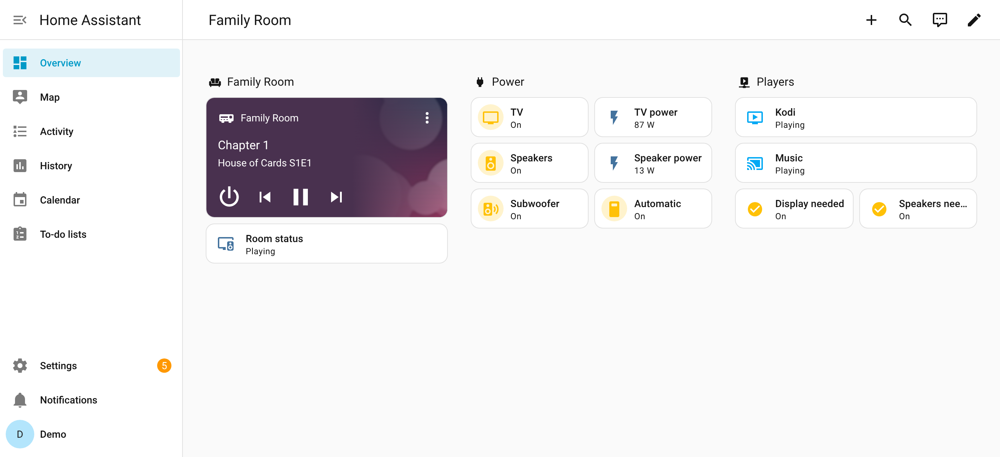
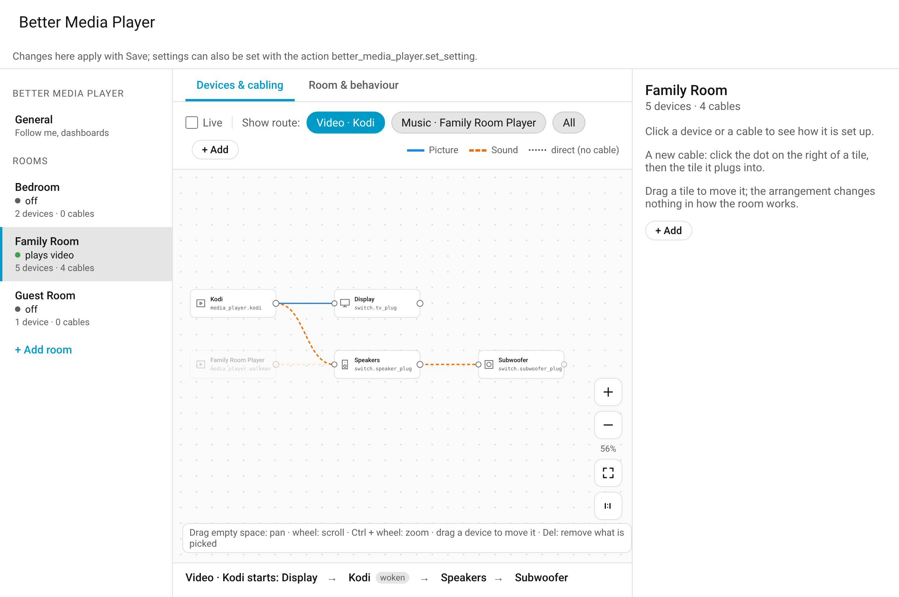

# Better Media Player

**One smart media player per room.** Better Media Player combines a room's media players (e.g. Kodi and a Music Assistant player) and its TV, speakers and subwoofer into a single Home Assistant entity. Press play and the right devices come on in a safe order; when nothing needs them any more, they go off again by themselves.

It is a custom integration in the spirit of Better Thermostat: you tell it what is in the room, it takes care of the rest.

## What it does

### In a room

- **[Power in the right order](https://github.com/financelurker/ha-better-media-player/blob/main/docs/room.md#order):** press play on Kodi → the TV comes on, Kodi wakes up, then the speakers; speakers never pop and a player is only used once it is ready.
- **[Several players, shared speakers](https://github.com/financelurker/ha-better-media-player/blob/main/docs/players.md):** any number of video and music players per room (Kodi, Music Assistant, any other media player) share one set of speakers; a player can [run on another](https://github.com/financelurker/ha-better-media-player/blob/main/docs/players.md#a-player-that-runs-on-another-player-or-a-device) – a Sendspin player in Kodi, HEOS on a receiver – and the room knows its music is no video.
- **[On and off by itself](https://github.com/financelurker/ha-better-media-player/blob/main/docs/room.md#when-devices-go-off):** music that starts on the room's player powers the speakers. When nothing plays any more, everything goes off after a while (30 min by default: the sound first, then the player, then the picture); a player you turn off takes everything with it at once.
- **[Inputs and CEC](https://github.com/financelurker/ha-better-media-player/blob/main/docs/devices.md):** tell the room how TV, AV receiver and players are cabled, and it switches the right inputs for what plays – or leaves switching to HDMI-CEC and only waits for it.
- **[Plugs or devices](https://github.com/financelurker/ha-better-media-player/blob/main/docs/room.md#devices-instead-of-plugs):** TV, speakers and subwoofer can hang on switchable plugs, turn themselves on and off (a TV or AV receiver as media player, a remote), be switched by your own scripts (e.g. IR) – or a mix.
- **[Room off](https://github.com/financelurker/ha-better-media-player/blob/main/docs/room.md#power-button-and-sources):** leaves a Music Assistant group, stops playback, turns the video player off and powers everything down.
- **[One volume per room](https://github.com/financelurker/ha-better-media-player/blob/main/docs/volume.md)**, with presets (quiet, normal, loud, party) – on the players or on an amplifier, AV receiver or soundbar.
- **[Night mode, sleep timer and wake up](https://github.com/financelurker/ha-better-media-player/blob/main/docs/night-sleep-wake.md)** with fades.
- **[Announcements](https://github.com/financelurker/ha-better-media-player/blob/main/docs/announcements.md)** over what plays: a room that is off powers up for it and goes off again; a video pauses; at night at most the night mode's limit.
- **[Media browser and search](https://github.com/financelurker/ha-better-media-player/blob/main/docs/media-browser.md)** across all of the room's players, with their queues on top; picking a movie powers up TV and Kodi first.
- **[Manual override](https://github.com/financelurker/ha-better-media-player/blob/main/docs/room.md#switched-by-hand):** switch a plug (or turn a device on) by hand and the room steps back until everything is off again.
- **[Tidy dashboards](https://github.com/financelurker/ha-better-media-player/blob/main/docs/dashboards.md):** controls that make no sense right now are hidden.
- **[For your own automations](https://github.com/financelurker/ha-better-media-player/blob/main/docs/automations.md):** events for source changes, night mode, sleep timer and wake up; device triggers for source changes and night mode.

### Across rooms

- **[Group playback](https://github.com/financelurker/ha-better-media-player/blob/main/docs/volume.md):** a Music Assistant group powers the speakers of every room in it; the group decides the volume, each room keeps its night mode's limit.
- **[Follow me](https://github.com/financelurker/ha-better-media-player/blob/main/docs/follow-me.md):** start it in a room and the music moves with you from room to room, using the rooms' occupancy sensors and one Music Assistant group player; it never takes over a room that plays something else and leaves quiet rooms out.
- **[Wake up with follow me](https://github.com/financelurker/ha-better-media-player/blob/main/docs/night-sleep-wake.md#with-follow-me):** the music follows you out of the bedroom.
- **[Handover](https://github.com/financelurker/ha-better-media-player/blob/main/docs/handover.md):** continue the music or the video in another room, where it was; the select offers only the rooms that can take it over.
- **[Announcements in several rooms](https://github.com/financelurker/ha-better-media-player/blob/main/docs/announcements.md):** rooms that play together as a group get it once, through the group, in step; quiet rooms are left out.
- **[Central settings](https://github.com/financelurker/ha-better-media-player/blob/main/docs/setup.md):** the follow-me player and the dynamic controls for all rooms.

## The panel

A page of its own in Home Assistant's sidebar, where the rooms are set up: every room as a drawing – its players, its devices, how they are cabled, and what each player needs when it starts – with the details of each device and the room's settings, checked before they are saved. [More about the panel](https://github.com/financelurker/ha-better-media-player/blob/main/docs/designer.md).

## Is it for you?

**It fits if**

- a room has video players (e.g. Kodi) and/or music players (e.g. Music Assistant players) – one or several, also other media players with the basic functions, or a player that runs on another one (a Sendspin player in Kodi);
- TV, speakers or subwoofer hang on switchable plugs (and start by themselves when they get power), turn on and off by themselves (a media player or a remote, e.g. a TV via webOS or CEC, an AV receiver, a Harmony hub), are switched by your own scripts (e.g. IR), or a mix of these;
- an AV receiver or TV switches between the players: with the room's [cabling](https://github.com/financelurker/ha-better-media-player/blob/main/docs/devices.md) (inputs chosen by the room or over HDMI-CEC);
- the room's volume is set on the players, or on an amplifier, AV receiver or soundbar with its own volume (a media player or a number);
- for follow me: occupancy sensors in the rooms and one Music Assistant group player with dynamic members.

**It does not fit (yet) if**

- several rooms (zones) hang on one device.

## Supported setups

Tested with simulated devices; **on real devices so far only scenario 0** (Kodi for video, a Sendspin device of Music Assistant for music). Feedback on the others is welcome.

- **[Scenario 0 – simple devices on plugs](https://github.com/financelurker/ha-better-media-player/blob/main/docs/devices.md#scenario-0-simple-devices-on-plugs):** TV, speakers and subwoofer on plugs, a video and a music player; no cabling needed. *In real use.*
- **[Scenario A – TV with CEC, AV receiver](https://github.com/financelurker/ha-better-media-player/blob/main/docs/devices.md#scenario-a-tv-with-cec-av-receiver-kodi):** the video player wakes the TV over CEC, the TV the receiver; music on the receiver's network input, chosen by the room. *Simulated only.*
- **[Scenario B – a music player in Kodi](https://github.com/financelurker/ha-better-media-player/blob/main/docs/devices.md#scenario-b-a-music-player-in-kodi):** Kodi for videos and a Sendspin player of Music Assistant in Kodi for music, through Kodi's sound; music in Kodi leaves the TV off. *Simulated only.*

## Installation

Requires Home Assistant 2025.2 or newer.

### HACS

1. Click the button above. It opens the repository in HACS and adds it as a custom repository if needed.
2. Install **Better Media Player** and restart Home Assistant.

Without the button: HACS → ⋮ → **Custom repositories** → add `https://github.com/financelurker/ha-better-media-player` as type *Integration*.

### Manual

1. Copy `custom_components/better_media_player` into `config/custom_components/`.
2. Restart Home Assistant.

## Getting started

1. Read [Before you start](https://github.com/financelurker/ha-better-media-player/blob/main/docs/setup.md): every plug and device belongs to exactly one controller.
2. Settings → Devices & services → Add integration → **Better Media Player** (once; the follow-me player is optional).
3. In the panel **Better Media Player** (sidebar): **+ Add room**, its players and devices, **Save** – once per room ([Setup](https://github.com/financelurker/ha-better-media-player/blob/main/docs/setup.md)).
4. Use the room player `media_player.<room>` like any media player: press play and the room powers up. How the room behaves (times, night mode, presets, …) are its settings, in the panel or with the action `better_media_player.set_setting`; the defaults are a good start.

## Documentation

| Page | Content |
|---|---|
| [Setup](https://github.com/financelurker/ha-better-media-player/blob/main/docs/setup.md) | adding the integration and the rooms, examples, the room's device and its settings |
| [How the room behaves](https://github.com/financelurker/ha-better-media-player/blob/main/docs/room.md) | power button and sources, order, when devices go off (one idle timeout, keep on), devices instead of plugs, standby, switched by hand |
| [Cabling and inputs](https://github.com/financelurker/ha-better-media-player/blob/main/docs/devices.md) | connections, inputs, CEC, supported setups |
| [The panel](https://github.com/financelurker/ha-better-media-player/blob/main/docs/designer.md) | where rooms are set up: devices, cables, routes, settings, saving |
| [Room volume](https://github.com/financelurker/ha-better-media-player/blob/main/docs/volume.md) | one volume per room, on an own device, presets |
| [Night mode, sleep timer and wake up](https://github.com/financelurker/ha-better-media-player/blob/main/docs/night-sleep-wake.md) | the night's limit, the sleep timer's fade-out, waking with a fade (also with follow me) |
| [Follow me](https://github.com/financelurker/ha-better-media-player/blob/main/docs/follow-me.md) | the music moves with you from room to room |
| [Handover](https://github.com/financelurker/ha-better-media-player/blob/main/docs/handover.md) | the music or the video goes on in another room |
| [Announcements](https://github.com/financelurker/ha-better-media-player/blob/main/docs/announcements.md) | which player announces, videos, volume, quiet rooms, several rooms |
| [Media browser and search](https://github.com/financelurker/ha-better-media-player/blob/main/docs/media-browser.md) | the browsers and queues of the room's players |
| [Automations](https://github.com/financelurker/ha-better-media-player/blob/main/docs/automations.md) | actions, events and device triggers, with YAML examples |
| [Dashboards](https://github.com/financelurker/ha-better-media-player/blob/main/docs/dashboards.md) | screenshots, dynamic controls, cards |
| [Reference](https://github.com/financelurker/ha-better-media-player/blob/main/docs/reference.md) | entities, settings, states |
| [Players of other systems](https://github.com/financelurker/ha-better-media-player/blob/main/docs/players.md) | Kodi, Better Kodi, Music Assistant and other players |

## Support

Questions, bugs and ideas: [GitHub issues](https://github.com/financelurker/ha-better-media-player/issues). For a bug, please add the Home Assistant version, what the room is set up with and a debug log (Settings → Devices & services → Better Media Player → ⋮ → **Enable debug logging**, reproduce it, then disable it again to download the log).

## License

Apache License 2.0, see [LICENSE](https://github.com/financelurker/ha-better-media-player/blob/main/LICENSE).

This project is not affiliated with Home Assistant, the Open Home Foundation, Kodi or Music Assistant.
