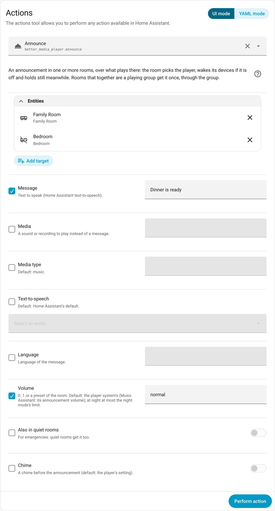

# Announcements

[← Back to the overview](../README.md)

A message or a sound in one or more rooms, over what plays there. With the action `better_media_player.announce`, or with anything that announces on a media player (e.g. `tts.speak` with the room player as its media player, or `media_player.play_media` with `announce: true`; [examples](automations.md#announcement)).

Screenshot: the action in the developer tools

**Which player announces.** A room prefers a player that supports Home Assistant's announcements (Music Assistant's players do; so does any other that offers it, e.g. a Better Kodi that brings it); without one it falls back to playing the announcement as usual media. The room takes the first that fits:

| Situation | Player | Why |
|---|---|---|
| Something plays and its player can announce | that player | the announcement takes the same way as what plays: the same speakers, the same input of an amplifier; the player holds what plays and resumes it itself |
| Something plays and its player cannot | the room's other player | it can; a film that plays meanwhile is paused, overlaid or turned down (*Announcement during video*) |
| The room is off | the music player, else the video player | the room's devices come up for it (speakers, volume device; a player that is off is woken; the announcement waits until they are through, including *Wait after speakers on* for speakers that need a moment) and go off right after, without run-down (with automatic power; in manual mode the room switches nothing). The same for devices that only came up for it while the room was on (e.g. speakers of the music player behind a film) |
| No player of the room can announce | a film plays and the music player is up and plays nothing: the music player (the film as above); else the player of what plays; the room is off: the music player, else the video player (fallback) | the announcement plays as usual media; what that player held is paused and starts again afterwards |

- **What the player's system does:** Music Assistant plays its chime, sets its announcement volume, holds the music and resumes it afterwards (players announcing through ESPHome duck the music instead). The action returns once all of that is over (an announcement that is not over after 5 minutes is taken as over). Turning the room off meanwhile: it goes off once the announcement is over.
- **Meanwhile the room holds still** (until a moment after the announcement): nothing the players do now counts as a wish – no volume learned (the preset stays), a pause is no snooze of a wake, no source change event; a preset fade, the night's fade back and a wake's fade hold and go on afterwards in the time they had left; the sleep timer waits. Announcements that overlap in a room are played one after the other (by the player's system, or by the room for the fallback); the room holds still until the last is over.
- **A film meanwhile** (the announcement on the music player): *Announcement during video* on the device – **pause** (default; it goes on afterwards; a video player that cannot pause is turned down instead), **overlay** (it plays on), **lower** (turned down by *Announcement: lower film by*, default 50 %, and back afterwards).
- **Volume:** the player system's (Music Assistant: its announcement volume per player), or `volume` of the action. **At night** at most the night mode's limit, also without `volume` (then the limit). With a volume device the device stays at the room volume (and keeps the night's limit) and the announcement's volume is the player's own: there a number applies, a preset does not.
- **Fallback** (no player of the room announces): the announcement plays at `volume`, else the room volume (at night at most the limit; with a volume device only a number of `volume` is set on the player; no chime: `pre_announce` is the player system's), then the player's volume comes back (unless changed meanwhile). What the player held starts again at its place, paused stays paused – best effort: its media is played again by its id (a queue or playlist may be lost, a stream starts anew, seeking where it can); without an id it can be played again by (e.g. Kodi's library items) it stays stopped. Nothing held before: it stops afterwards. Something you start on it meanwhile is left as it is. Not on a player in a group (the group's queue would be lost): the room then has no player for it. Turning the room off meanwhile: nothing starts again.
- **Quiet rooms are left out** (see below), unless `ignore_quiet: true`.
- **Several rooms** at once: rooms that together are all the members of a group that plays (e.g. follow me; the group's player must announce too) get it once, through the group, in step; the group goes on afterwards. Only some rooms of a group, a paused group, or a room with a film: each on its own player, the group plays on in the others. If a room fails (e.g. its players are in a group, or a preset it does not offer), the others still get it and the action reports the error afterwards.

**Quiet and night mode:** the **night mode** is about *how loud* the room is (its limit, no subwoofer, shorter times) – for everything that plays there, also what you start. **Quiet** is about whether anything *from outside* comes in ("do not disturb", e.g. a baby asleep in the room): follow me leaves the room out and announcements skip it; what you start in the room itself (room player, wake, playing something) works as usual.

Good to know:

- At night (with the limit given as the announcement's volume), Music Assistant leaves the ESPHome route for a player that announces through ESPHome: the player is taken out of its group for the announcement and the music pauses instead of ducking, then it rejoins.
- Music Assistant's own minimum and maximum announcement volume (per player) still apply and may override the night mode's limit.
- Only announcements through the room player (or the action) are handled by the room: one sent to the Music Assistant player directly bypasses it, as for all of the room's features.
- An AV receiver on another input (e.g. the TV's) does not play an announcement of the music player; switching its input for announcements is not part of this (yet).

---

Related: [Night mode](night-sleep-wake.md#night-mode) · [Follow me](follow-me.md) · [Settings](reference.md#settings)
