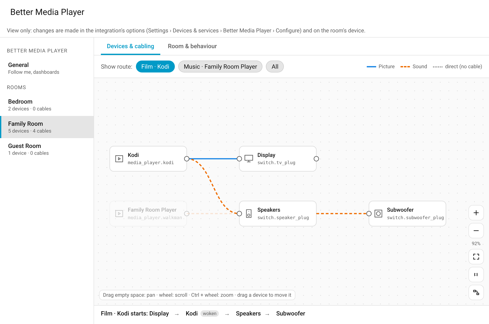
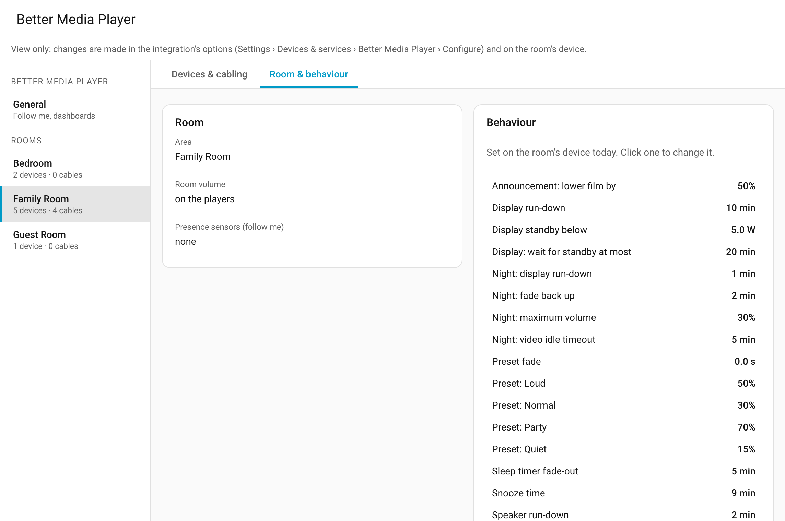

# The panel

[← Back to the overview](../README.md)

Better Media Player has a page of its own in Home Assistant's sidebar: **Better Media Player** (for admins). It shows every room as a drawing – its players, its devices and how they are cabled – and which devices each player needs when it starts.

**In this release the panel only shows.** Rooms are still set up in the integration's options (Settings → Devices & services → Better Media Player → **Configure**), and how a room behaves is set on its device. Editing in the panel comes in a later release.

Tested on a local Home Assistant 2026.2 with the demo integration (simulated devices).

## Opening the panel

- **Sidebar:** *Better Media Player*.
- **Address:** `/better-media-player`, also when the sidebar entry is hidden (in the sidebar settings or by another integration).
- **From a room's device:** the device page's **Visit** link opens that room in the panel; the central device's link opens the panel.
- **From a dashboard:** any card that navigates, to `/better-media-player`.

## A room's drawing

- **Tiles:** the room's players on the left, its devices to the right of what feeds them: display, speakers, subwoofer. A device with its own CEC switching carries a *CEC* mark. Each tile shows the plug or device that powers it.
- **Cables:** what the room's [cabling](devices.md) describes. Picture is blue, sound orange and dashed; an input to choose is written on the cable (*· CEC* when HDMI-CEC chooses it).
- **Dotted lines:** a device no cable reaches is fed directly, as in a room without cabling – the display gets the picture, speakers and subwoofer get the sound.
- **Show route:** pick a player to highlight what it needs when it starts; below the drawing, the order in which the devices come on and the inputs they are switched to. *All* shows every cable.
- **Details:** click a tile or a cable, and its details open on the right (× closes them; the drawing has the whole width otherwise). A player shows its entity, the plug of its hardware and its own actions; a device its plugs, the devices that switch themselves, its power sensors, who switches it on and off, its inputs and the players it is needed for; a cable what it carries and its input. A click on an entity opens it.

The routes are worked out by the integration, with the same calculation that switches the room.

## Moving around

- **Pan:** drag empty space, or scroll with the wheel.
- **Zoom:** Ctrl + wheel (or a trackpad pinch), or the buttons. With the drawing focused (click into it), also the keys + and −; **0** fits the drawing to the screen, **1** shows it at its actual size.
- **Arrange:** drag a tile to another place; the room keeps the arrangement (it changes nothing in how the room works). *Arrange automatically* places everything anew. Only for a room that is loaded (one that is not shows its devices from its setup).

## Room & behaviour

- **Room:** its area, where its volume is set, its presence sensors for follow me.
- **Behaviour:** the settings on the room's device (run-downs, night mode, presets, …) with their values. A click opens the setting to change it.
- **General** (left): the follow-me player and the central settings.

On a phone the rooms are a row above the drawing, the details below it.
