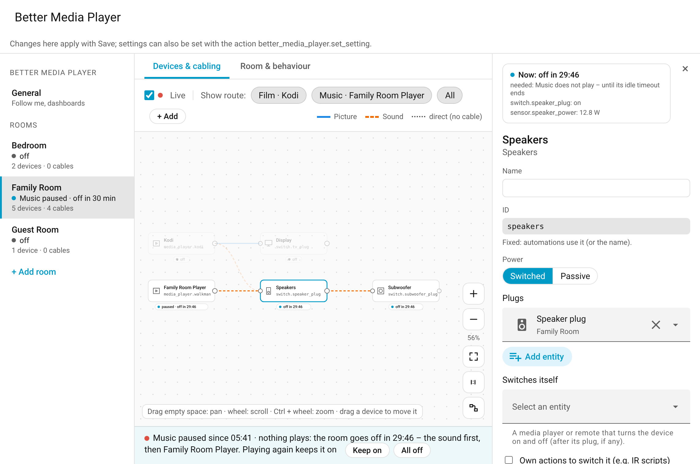

# The panel

[← Back to the overview](../README.md)

Better Media Player has a page of its own in Home Assistant's sidebar: **Better Media Player** (for admins). Every room is set up and changed here: its players, its devices, how they are cabled, and how it behaves. It shows each room as a drawing, with what each player needs when it starts.

Tested on a local Home Assistant 2026.10 with the demo integration (simulated devices).

## Opening the panel

- **Sidebar:** *Better Media Player* (there once the integration is added: Settings → Devices & services → Add integration → **Better Media Player**).
- **Address:** `/better-media-player`, also when the sidebar entry is hidden (in the sidebar settings or by another integration).
- **From Home Assistant:** **Configure** of a room's entry (Settings → Devices & services → Better Media Player) and the **Visit** link on a room's device page open that room; the central entry's open the panel.
- **From a dashboard:** any card that navigates, to `/better-media-player`.

## Changing and saving

- Changes collect until **Save** in the bar at the top; **Discard** drops them. The bar is for all rooms and the general page at once; a room with unsaved changes has a dot in the list.
- **Errors stop saving** (the bar names the first, the room's list all of them): no player, a cable in a circle, two inputs one player would need on one device, a device without anything to switch it, an invalid or doubled ID, a plug or device another room already switches. **Hints** do not: an input the device does not offer, a device on no player's way.
- **Settings** (times, presets, …) take effect at once with Save. A changed **setup** (players, devices, cables, volume, presence sensors, name) sets the room up again; a room that plays says so in the bar – what is on stays on, playback goes on.
- Only what you changed is saved: a setting an automation changed meanwhile (the action `set_setting`) stays, unless you changed the same one here.
- A room changed in another window meanwhile is not saved over: saving stops at that room and says so. Rooms saved before it stay saved, the others keep their unsaved changes; **Discard** shows the room as it is now.

## A room's drawing

- **Tiles:** the room's players on the left, its devices to the right of what feeds them. A device switched by HDMI-CEC carries a *CEC* mark, the one the room's volume is set on *Room volume*. Each tile shows the plug or device that powers it; a passive one (mixer, splitter, passive speakers) has a dashed frame.
- **Cables:** what the room's [cabling](devices.md) describes. Picture is blue, sound orange and dashed; an input to choose is written on the cable (*· CEC* when HDMI-CEC chooses it).
- **Dotted lines:** a device no cable reaches is fed directly, as in a room without cabling – a display gets the picture, speakers, subwoofer, receiver and amplifier get the sound.
- **A room without cables** (as one set up with v1.2.0 is taken over) works through these dotted lines. *Take over the dotted lines as cables* (on the right, with nothing picked) turns them into cables – the room works the same – so the cabling can be changed from there: a mixer or splitter in between, inputs to choose. It is an unsaved change until Save.
- **Show route:** pick a player to highlight what it needs when it starts; below the drawing, the order in which the devices come on and the inputs they are switched to. *All* shows every cable.
- **Problems** of the room are listed above the drawing; a tile with an error has a red frame.

## Live

With **Live** on (the switch above the drawing, on by default and remembered in the browser), the drawing shows what the room does right now:

- **Under each tile** a line: a player *playing*, *paused · off in 7:42* (counting down; an hour or more: the time), *starting …*, *going off*; a device *on · HDMI 2* (its input), *on · → HDMI 2* (being chosen), *waiting for CEC · 8 s*, *off in 7:42*, *waiting for standby · 12 W*, *waits for the player*, *by hand · HDMI 1*, *night: off*, *kept on*, *off*.
- **Cables:** the route in use is shown, the rest dimmed; while it plays, dots run along its cables (not with reduced motion).
- **Below the drawing** a sentence on what the room does, with **Keep on** (or **Release**) and **All off** where they make sense.
- **Details** of a tile you click: its state, why it is on (a player plays, its idle timeout, a wake, an announcement, follow me), its entities' states and its input.
- **Rooms list:** a line per room (*plays film*, *film paused · off in 29 min*, *starting …*, *kept on*, *start failed*, *off*).

Picking a route (*Show route*) turns Live off; switching it on again shows what runs. While a room's setup has unsaved changes, Live waits: the drawing then shows the changes, not what runs.

## Players, devices and cables

- **+ Add** (above the drawing): a player – a video player (needs picture and sound) or a music player (needs the sound); as many as the room has, a player of the room's area is proposed for the first of each; offered are only players that are free – not already a player or device of a room, not a room player of Better Media Player, a group or the follow-me player – and of the room's area or of none – or a device: display, AV receiver / soundbar, amplifier, speakers, subwoofer, HDMI switch, mixer, splitter, passive speakers.
- **A cable:** click the right dot of a tile, then the tile it plugs into (Esc cancels). What it carries is proposed from the two ends.
- **Details:** click a tile or a cable, and they open on the right (× goes back to the room's overview there). Entities and the area are picked with Home Assistant's own selector (search by name, area or ID; only entities that fit the field are offered).

| Details of | What you set |
|---|---|
| **A player** | Its entity and ID (`video` and `audio` for the first of each, else `video_2`, `audio_2`, …; it can be changed until the player is saved, then it is fixed: automations use it, e.g. `source:` of `wake`). *Needs*: picture and sound, or sound only (what it is for; the players with the IDs `video` and `audio` keep theirs). *Kind of player*: what its system brings (Kodi, Better Kodi, Music Assistant, or a media player with the basic functions – see [Players of other systems](players.md)). *Runs on*: its own hardware, or another player or device it [runs on](players.md#a-player-that-runs-on-another-player-or-a-device) (e.g. Sendspin in Kodi): then it has no plug and no cables of its own. *Switched on and off by*: **Automatic** (the player's own on/off if it offers one, e.g. Kodi with your Wake-on-LAN, else its own actions), **Player**, **Actions** (a script or button each), **None** (the room only wakes it by playing). The plug of its hardware, with its waits (after it is on; before it goes off, for the player to shut down). |
| **A device** | Name and ID (the ID can be changed until the device is saved, then it is fixed: automations use it, e.g. `set_setting` with `device:`). *Switched* or *Passive*; plugs, devices that switch themselves (a TV, an AV receiver, a remote), own on/off actions, power sensors (for [waiting for standby](room.md#wait-for-standby)); who switches it on and off (BMP, CEC, never). Inputs: via a media player's source list, or an action per input (IR). Its volume, and *Use as the room's volume*. Its settings: wait after on, standby, off at night. |
| **A cable** | What it carries, the input on the device, who chooses it (BMP, CEC, never); *Insert in between* puts a mixer or a splitter into it. |

**Del** (or Backspace) removes the picked cable, device or player, like its *Remove* button in the details (not while typing in a field). Removing a player or a device removes its cables (and its settings). Like every change, it is undone with **Discard** until you save.

## Room & behaviour

- **Room:** name, area (the room's device's), *Delete room* – at once, after a question: its room player, controls and device go; its devices are not touched.
- **Players:** *Starts with* – the player the room starts with when it is turned on (and for a wake that names no source); without one, the player used last. *Main music player* (with several music players): follow me and announcements use the music player that plays, else this one.
- **Room volume:** on the players, or on a device of the room that has a volume.
- **Follow me:** presence sensors; with them the room takes part.
- **Behaviour:** the room's settings (night, presets, times, announcements, sleep timer and wake, follow me); its devices' are in their details. All of them: [Reference](reference.md#settings).
- **General** (left): the follow-me player and the central settings.

A new room (**+ Add room**, left) starts on this page; it is created with Save, once it has a player.

## Moving around

- **Pan:** drag empty space, or scroll with the wheel.
- **Zoom:** Ctrl + wheel (or a trackpad pinch), or the buttons. With the drawing focused (click into it), also the keys + and −; **0** fits the drawing to the screen, **1** shows it at its actual size.
- **Arrange:** drag a tile to another place; the room keeps the arrangement at once (it changes nothing in how the room works). *Arrange automatically* places everything anew.

On a phone the rooms are a row above the drawing, the details below it.
