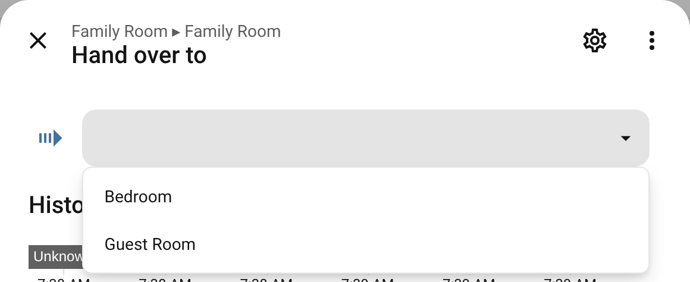

# Handover

[← Back to the overview](../README.md)

Continue what plays in one room in another: the music or the film goes on there, this room goes off. With the room's select **Hand over to** (it offers the rooms that can take it over, while something plays) or the action `better_media_player.handover` ([example](automations.md#handover)).

- **The destination powers up first** (its power sequence for that source: TV, player, speakers), then the playback moves: **music** with its queue, going on where the track was, paused music stays paused (Music Assistant); **video** with Better Kodi's handover (it continues where the film was). The destination plays at its own room volume (night mode and presets apply there).
- **What the destination played before** is replaced, as with a source change.
- **During follow me**, handing the music over ends follow me: the music goes to the destination, the other rooms stop.
- **This room goes off** afterwards (its sleep timer or wake end with it), unless `keep_source_playing` (only where the player's system can: Better Kodi; a Music Assistant queue moves), or its other source is in use (e.g. paused music handed over from behind a film: the film plays on).
- **Music in a group** (other than follow me) is not handed over: the group plays it, not the room's player.
- Both rooms need a player for the source with handover: the same system (two Music Assistant players, two Better Kodi players). Otherwise the action gives an error that says why (nothing plays, no such player in the destination, the system cannot hand over, …); errors of the player's own handover (e.g. Better Kodi's) are passed on.

---

Related: [Follow me](follow-me.md) · [Players of other systems](players.md)
