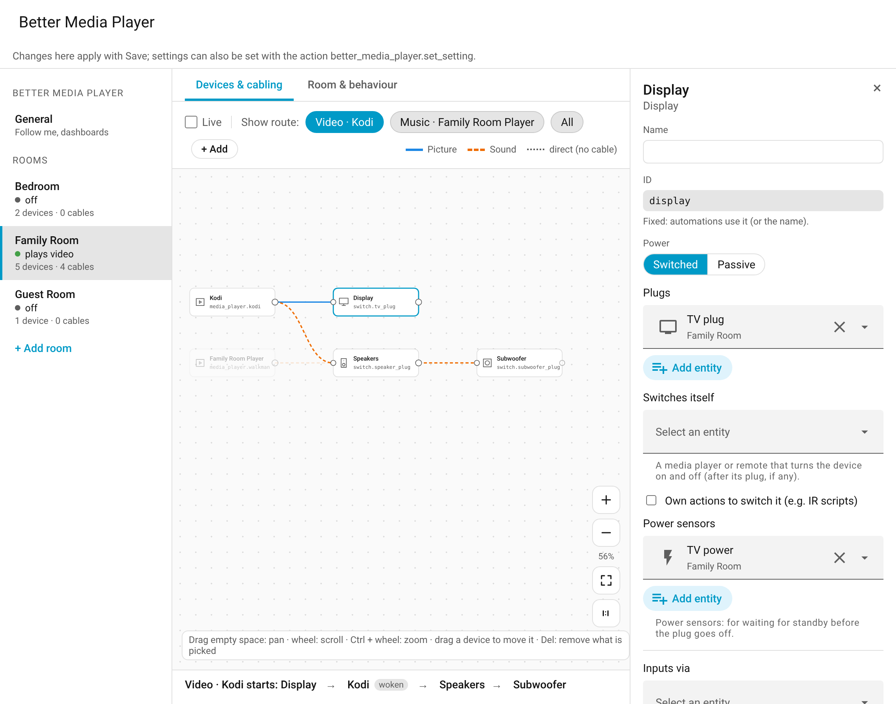
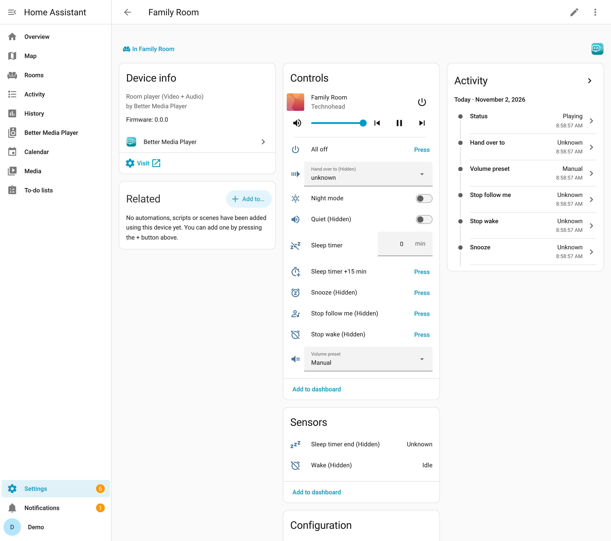

# Setup

[← Back to the overview](../README.md)

Set up Better Media Player once it is [installed](../README.md#installation): add the integration, then the rooms in its panel – what is connected and how each room behaves.

> **Before you start**
>
> - Every plug and device belongs to exactly one controller. Disable automations, scripts or helpers that switch the same plugs or devices (Settings → Entities → plug → **Related** shows them). Devices on a plug alone must start by themselves when they get power.
> - **Kodi:** Home Assistant cannot switch Kodi on or off by itself: `turn_on` / `turn_off` only fire Kodi's device triggers. Keep your Wake-on-LAN and suspend automations on these triggers; they do the actual work.

1. **Add the integration:** Settings → Devices & services → Add integration → **Better Media Player**. It asks only for the follow-me player (optional, also later in the panel). The panel **Better Media Player** appears in the sidebar.
2. **Add a room** in the panel (**+ Add room**, left): name and area.
3. **Its players and devices** (Devices & cabling → **+ Add**): a video player (e.g. Kodi) and/or a music player (the room's own player, not a group) – one of the room's area is proposed; then its devices – display, AV receiver or soundbar, amplifier, speakers, subwoofer – and in each device's details what switches it: plugs and/or the [device itself](room.md#devices-instead-of-plugs) (a media player or remote), or own on/off actions (e.g. IR scripts); power sensors for [waiting for standby](room.md#wait-for-standby). A player whose hardware hangs on a plug gets that plug in its details.
4. **Optional:** cables (inputs, CEC: [Cabling and inputs](devices.md)), where the room's volume is set, presence sensors for follow me (Room & behaviour).
5. **Save.** The room appears as a device with its room player `media_player.<room>`.

Since Home Assistant 2026.6, new entity ids start with the area's name: a room named like its area gets e.g. `media_player.living_room_living_room` (rename it in the entity's settings if you like). These pages write `<room>` for the room's part.

Everything can be changed later in the panel ([The panel](designer.md)); **Configure** of a room's entry opens it there.

## Examples

| Room | Media players | Power devices |
|---|---|---|
| TV room | Kodi | TV, speakers |
| Office | Music Assistant player | speakers |
| Living room | Kodi + Music Assistant player | TV, speakers (shared), subwoofer |
| Home cinema | Kodi + Music Assistant player | TV (webOS, as media player; keep its [Wake-on-LAN automation](room.md#devices-instead-of-plugs)), AV receiver on a plug (plug, then the receiver) with the room volume on the receiver, subwoofer by IR scripts (an on and an off action) |

## The room's device and its settings

Each room is a device (Settings → Devices & services → Better Media Player → the room). Its page shows the status, what is needed right now, automatic power, the *All off* button and the room's controls:

How the room behaves – times, waits, standby, night mode, volume presets and follow me – are the room's settings, each device of the room has its own (wait after on, standby, off at night). The [panel](designer.md) shows them; the action `better_media_player.set_setting` changes one, at once and kept ([examples](automations.md#settings)). To start, you can leave them all at their defaults. All of them, with their defaults: [Reference](reference.md#settings).

The **Central settings** (follow me's player and default volume, dynamic controls, hide delay, hiding the used entities) are on the panel's page *General*, or set with the action, without a room.

## Hide the used entities

The room players stand in for the players and devices behind them. With the central setting **Hide used entities** (`hide_used`, default `none`), those entities are hidden in Home Assistant (as *hidden by the integration*); they still work in your own cards, automations and Music Assistant.

| Value | Hidden |
|---|---|
| `none` | nothing |
| `players` | the rooms' players (Kodi, music players) and the follow-me player |
| `devices` | also the devices' media players (TV, AV receiver; as a device, the volume or the inputs) |
| `all` | everything a room is set up with (plugs, remotes, actions, power sensors), not its presence sensors |

- Only what Better Media Player hid is shown again: when the value goes down, when no enabled room uses an entity any more (removed from the room, the room deleted or disabled), and when the central settings are removed or disabled.
- What you hid yourself stays hidden. One you show again yourself stays shown, until the setting is set to `none` once (or the entity is no longer used).
- An entity without a unique id cannot be hidden.

## Repairs

What a room is set up with is checked against Home Assistant:

- **A renamed entity** (new entity id) is followed: the room takes the new id by itself.
- **Settings → Repairs** shows, until the cause is gone:
  - entities a room is set up with that do not exist (any more) or are disabled (an error for a missing player, a warning otherwise; checked from a minute after Home Assistant has started, as some integrations add their entities late);
  - plugs, devices or players that several rooms switch (each belongs to one room; sensors may be shared);
  - a group player as a room's player, or a follow-me player that is no Music Assistant group player;
  - after the update from version 1.2: automations or scripts that still use a setting entity of before (they are removed; change them to the action `better_media_player.set_setting`, see [Reference](reference.md#up-to-version-12)).

Fix the others in the panel.

---

Related: [How the room behaves](room.md) · [Room volume](volume.md) · [Reference](reference.md)
