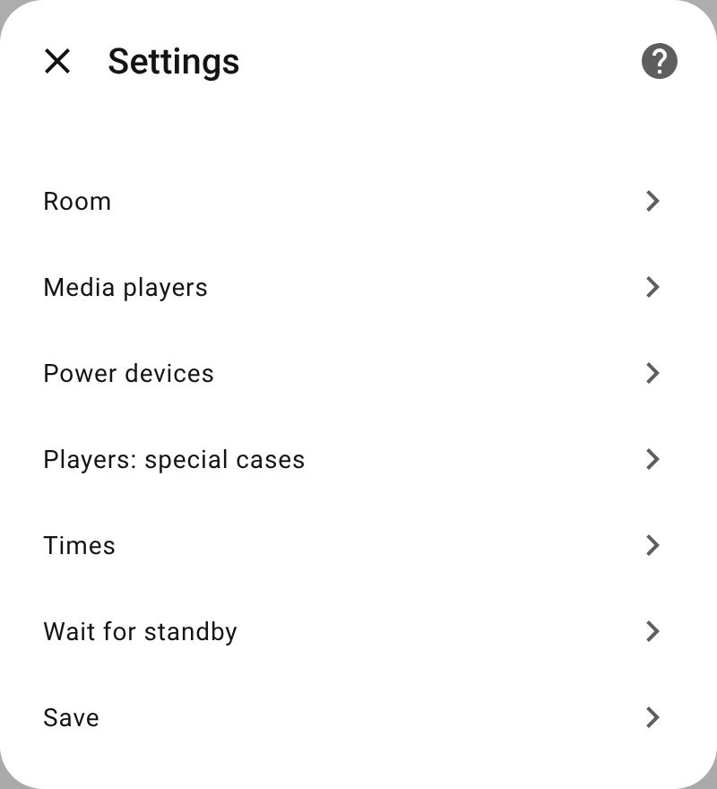
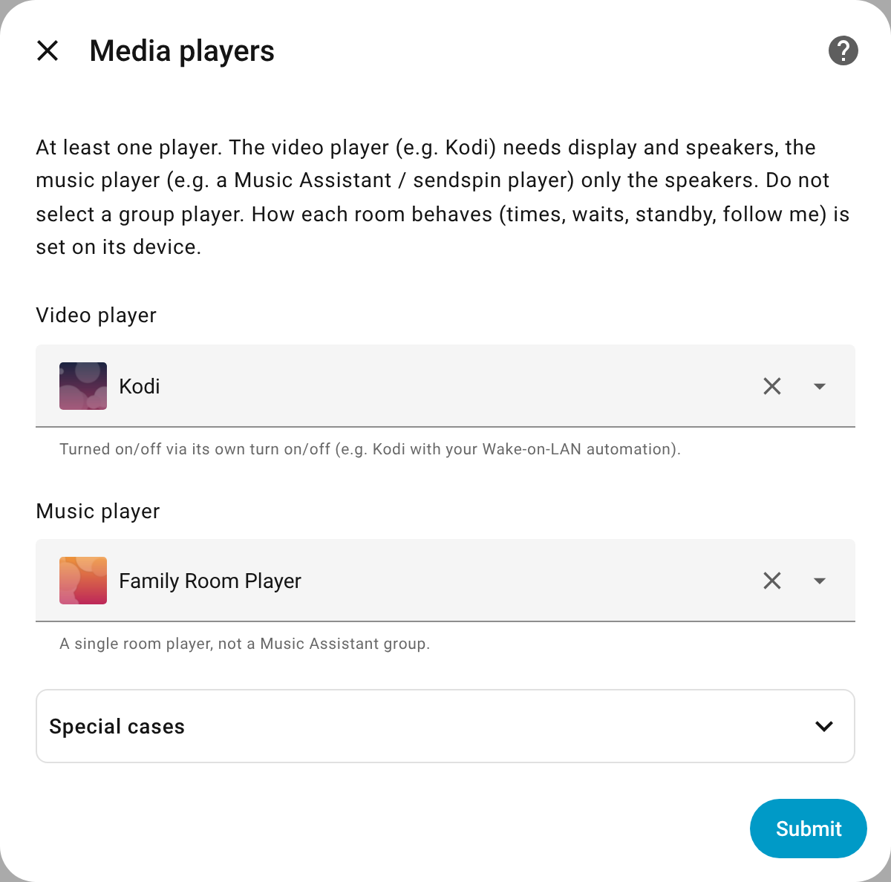
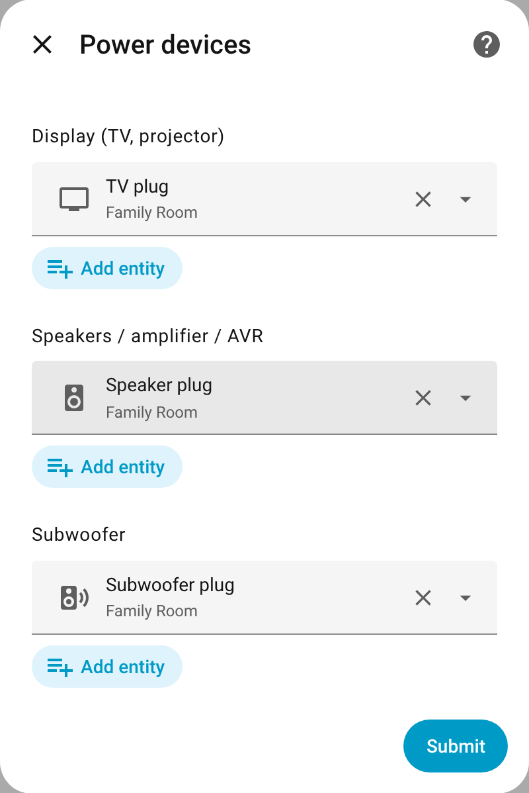

# Setup

[← Back to the overview](../README.md)

Set up a room once Better Media Player is [installed](../README.md#installation): what is connected in the setup, how the room behaves on its device.

> **Before you start**
>
> - Every plug and device belongs to exactly one controller. Disable automations, scripts or helpers that switch the same plugs or devices (Settings → Entities → plug → **Related** shows them). Devices on a plug alone must start by themselves when they get power.
> - **Kodi:** Home Assistant cannot switch Kodi on or off by itself: `turn_on` / `turn_off` only fire Kodi's device triggers. Keep your Wake-on-LAN and suspend automations on these triggers; they do the actual work.

Settings → Devices & services → Add integration → **Better Media Player** → **A room**, once per room. For follow me, or to change the [dynamic controls](dashboards.md#dynamic-controls), add **Central settings** once as well.

The setup only asks what is connected:

| Step | What you enter |
|---|---|
| **New room** | Name and area. Kodi (also Better Kodi) and Music Assistant players of the area are pre-selected in the next step. |
| **Media players** | Video player (e.g. Kodi) and/or music player (the room's own player, not a group). *Special cases* (collapsed): on/off actions for a player that cannot turn itself on/off, plugs its hardware hangs on. |
| **Devices and volume** | Display (TV, projector), speakers (one or more: active speakers, amplifier, AVR), subwoofer: plugs and/or [devices](room.md#devices-instead-of-plugs). Where the room's volume is set: on the players, or on an own device. *Own on/off actions* (collapsed): scripts or buttons for a device only they switch. *Wait for standby* (collapsed): power sensors. *Follow me* (collapsed): occupancy sensors; rooms without them do not take part. |

Since Home Assistant 2026.6, new entity ids start with the area's name: a room named like its area gets e.g. `media_player.living_room_living_room` (rename it in the entity's settings if you like). These pages write `<room>` for the room's part.

Everything can be changed later via **Configure**; there, **Cabling (inputs, CEC)** tells the room how its players and devices are connected, so it chooses the right inputs ([Cabling and inputs](devices.md)). How the room behaves is set on its device (below).

| Menu | Media players | Devices and volume |
|---|---|---|
|  |  |  |

## Examples

| Room | Media players | Power devices |
|---|---|---|
| TV room | Kodi | TV, speakers |
| Office | Music Assistant player | speakers |
| Living room | Kodi + Music Assistant player | TV, speakers (shared), subwoofer |
| Home cinema | Kodi + Music Assistant player | TV (webOS, as media player; keep its [Wake-on-LAN automation](room.md#devices-instead-of-plugs)), AV receiver on a plug (plug, then the receiver) with the room volume on the receiver, subwoofer by IR scripts (an on and an off action) |

## The room's device and its settings

Each room is a device (Settings → Devices & services → Better Media Player → the room). Its page shows the status, what is needed right now, automatic power, the *All off* button and the room's controls:

How the room behaves – times, waits, standby, night mode, volume presets and follow me – are the room's settings, each device of the room has its own (run-down, wait after on, standby, off at night). The [panel](designer.md) shows them; the action `better_media_player.set_setting` changes one, at once and kept ([examples](automations.md#settings)). To start, you can leave them all at their defaults. All of them, with their defaults: [Reference](reference.md#settings).

The **Central settings** (follow me's default volume, dynamic controls, hide delay) are set the same way, without a room; the central entry's **Configure** only asks for the follow-me player.

## Repairs

What a room is set up with is checked against Home Assistant:

- **A renamed entity** (new entity id) is followed: the room takes the new id by itself.
- **Settings → Repairs** shows, until the cause is gone:
  - entities a room is set up with that do not exist (any more) or are disabled (an error for a missing player, a warning otherwise; checked from a minute after Home Assistant has started, as some integrations add their entities late);
  - plugs, devices or players that several rooms switch (each belongs to one room; sensors may be shared);
  - a group player as a room's player, or a follow-me player that is no Music Assistant group player;
  - after the update from version 1.2: automations or scripts that still use a setting entity of before (they are removed; change them to the action `better_media_player.set_setting`, see [Reference](reference.md#up-to-version-12)).

Fix the others under **Configure** of the room (or of the central settings).

---

Related: [How the room behaves](room.md) · [Room volume](volume.md) · [Reference](reference.md)
